> **Workshop GitHub Repository**: [https://github.com/nuno-joao-andrade-dev/ptw_lisbon_2026](https://github.com/nuno-joao-andrade-dev/ptw_lisbon_2026)
> **Interactive Presentation Slides**: [https://nuno-joao-andrade-dev.github.io/ptw_lisbon_2026/slides/](https://nuno-joao-andrade-dev.github.io/ptw_lisbon_2026/slides/) ([Source in Repo](https://github.com/nuno-joao-andrade-dev/ptw_lisbon_2026/tree/main/slides))
>
> ```bash
> git clone https://github.com/nuno-joao-andrade-dev/ptw_lisbon_2026.git
> cd ptw_lisbon_2026
> npm install && npm run build:ui
> ollama pull gemma4:e2b
> npm test
> ```

> **Special Thanks**: A special thank you to **[Portugal Tech Week](https://portugaltechweek.com/)**, **[Kátia Sidorenko](https://www.linkedin.com/in/sidorina-katerenko/)**, and **[Laura Andrade](https://www.linkedin.com/in/lauraandrade2025/)** for the warm invitation, organization, and support in making this hands-on session in Lisbon possible!

> [!IMPORTANT]
> **⚠️ Workshop Educational Guide Disclaimer:** This project and workshop were built strictly as an **educational guide to help founders and engineers better pitch their projects** and learn multimodal AI engineering with Gemma 4. The verdicts, scores, and roasts generated by this system are **not real investment competition results or formal financial advice**.

At **Portugal Tech Week 2026**, we tackled one of the most relatable challenges in every startup ecosystem: **how do you give founders brutally honest, mathematically grounded feedback on their 30-second elevator pitch and slide deck without uploading confidential pre-seed financials to third-party cloud APIs?**

Using **Google's Gemma 4 (`gemma4:e2b`)** running 100% locally on **Ollama**, we built the **Multimodal Pitch & Deck Critic ("AI Investment Committee")** in **Node.js and React 19**. Across five progressive architectural milestones, our agent evolves from a 20-second single-turn startup roast into a full-stack multimodal pitch arena capable of ingesting raw `16kHz` PCM WAV audio without an external Whisper step, dynamically switching slide vision token budgets between **280 tokens** (`448×448` layout mode) and **1,120 tokens** (`1120×1120` dense financial table & 8pt footnote OCR mode), catching cross-modal contradictions between what a founder says and what their slides show, and verifying unit economics with deterministic Venture Capital tools.

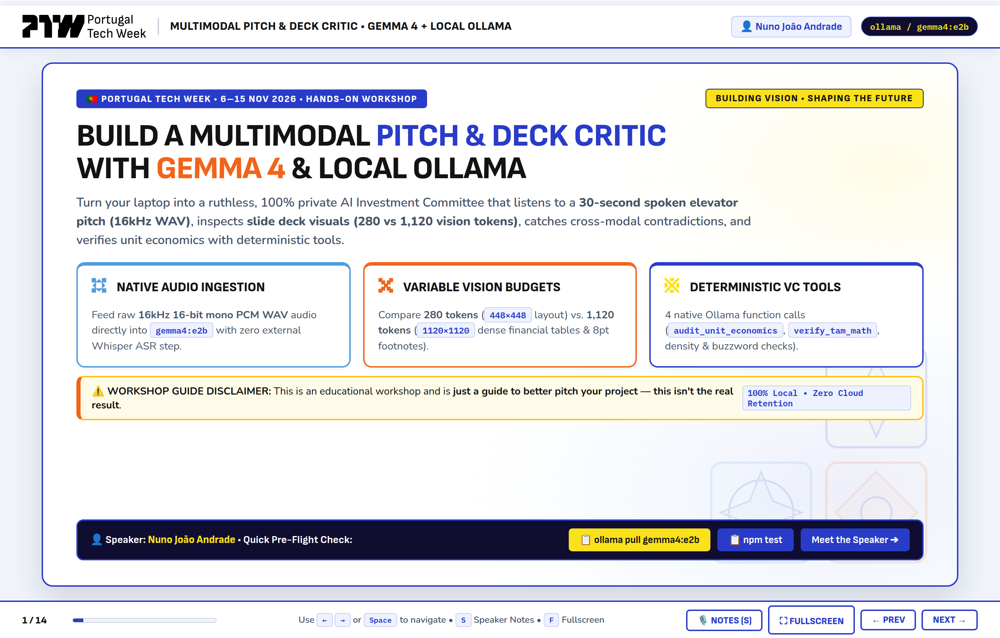

---

## Meet the Workshop Instructor: Nuno João Andrade

Before diving into the architecture and code, here is a quick introduction from **Slide 2** of the workshop deck:

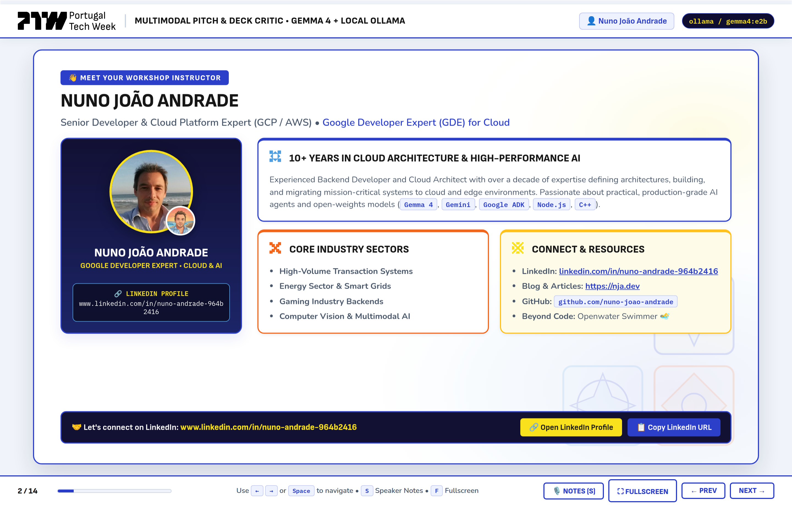

- **Nuno João Andrade** — Senior Backend Developer, Cloud Platform Architect (GCP / AWS), and **Google Developer Expert (GDE) for Cloud**.
- **Experience:** 10+ years defining architectures, building, and migrating mission-critical systems across high-volume transaction platforms, the energy sector, gaming backends, and computer vision / multimodal AI using `Gemma 4`, `Gemini`, `Node.js`, and `C++`.
- **Connect on LinkedIn:** [www.linkedin.com/in/nuno-andrade-964b2416](https://www.linkedin.com/in/nuno-andrade-964b2416)
- **Blog & Technical Articles:** [https://nja.dev](https://nja.dev)

---

## 1. Why Text-Only Pitch Coaching Fails — And How Native Multimodal Fixes It

Every startup accelerator demo day has the same unspoken problem: founders rehearse their 30-second elevator pitch in front of polite friends who nod encouragingly, while their slide deck quietly contradicts half of what they just said out loud.

Consider what happens in a real 30-second pitch:
1. **On the microphone (Audio):** The founder confidently declares, *"We are growing 25% month-over-month, our LTV-to-CAC ratio is an elite 4.8x, and our net burn multiple is 1.0x!"*
2. **On Slide #2 (Vision):** A dense financial table shows revenue grew from `$220k` to `$240k` (**9.1% MoM**, not 25%), and an 8-point footnote at the very bottom admits: *"*Footnote: Spoken pitch figures exclude $190k/mo AWS GPU cluster costs and 4.2% monthly logo churn."*
3. **In the numbers (Math):** When you actually divide `$140k` net burn by `$40k` net new ARR, the startup's real burn multiple is **3.50x**—an instant red flag for any seed or Series A investor.

When you transcribe a founder's spoken pitch with an external ASR model before feeding it to a text-only LLM, you lose vocal pacing, hesitation cues, and native cross-modal grounding. Worse yet, if you downsample every slide image to a single fixed resolution, you either waste 4× compute on minimalist title slides or blur 8-point financial footnotes into illegibility.

| Failure Mode | Traditional ASR + Text LLM Pipeline | Naive Vision Prompting (Fixed Resolution) | Our Gemma 4 + Local Ollama Architecture |
| :--- | :--- | :--- | :--- |
| **Audio Delivery & Pacing** | Transcription strips out WPM pacing, vocal energy, and hesitation cadence. | Not supported without external Whisper pipeline. | **Native 16kHz PCM WAV Ingestion:** `gemma4:e2b` processes raw base64 audio + slide images in a single multimodal context window. |
| **Slide OCR vs. Latency** | Relies on brittle external PDF/OCR text extraction that breaks on multi-column tables. | Downscales all slides equally—8pt financial footnotes become unreadable blur. | **Variable Vision Token Budgets (`shared/visionBudget.js`):** Per-slide selection between **280 tokens** (`448×448` layout mode) and **1,120 tokens** (`1120×1120` dense table/footnote OCR mode). |
| **Financial & TAM Arithmetic** | LLMs routinely guess arithmetic ratios (`LTV:CAC`, `Burn Multiple`) via next-token probability. | Model accepts whatever vanity metric is printed in 48pt font on the slide. | **Deterministic VC Tool Calling (`shared/tools.js`):** Model invokes `audit_unit_economics`, `verify_tam_math`, `check_slide_density`, and `flag_buzzword_overload` executed in pure Node.js. |
| **Data Privacy & Cost** | Pre-launch financials, customer logos, and voice recordings are sent to external cloud APIs. | High per-token cloud vision & audio API billing during live events. | **100% Local & Zero API Keys:** Runs entirely on `http://localhost:11434` via Ollama with zero cloud retention. |

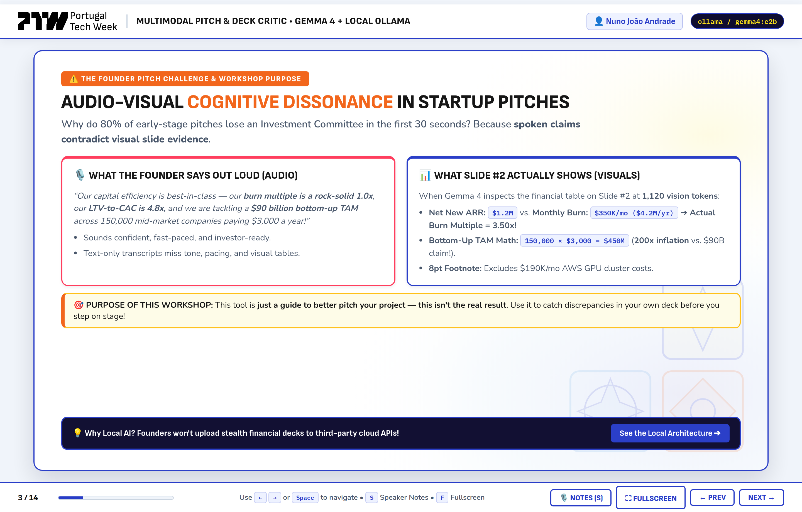

---

## 2. End-to-End System Architecture

Our Multimodal Pitch & Deck Critic is architected around a clean separation of concerns between **multimodal perception** (handled by `gemma4:e2b`), **deterministic financial math** (handled by pure Node.js tools in `shared/tools.js`), and **runtime schema enforcement** (handled by `zod` in `shared/schemas.js`).

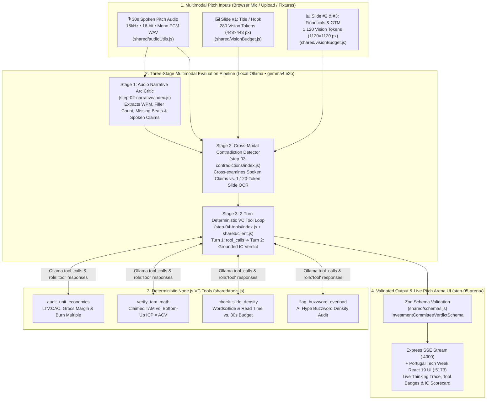

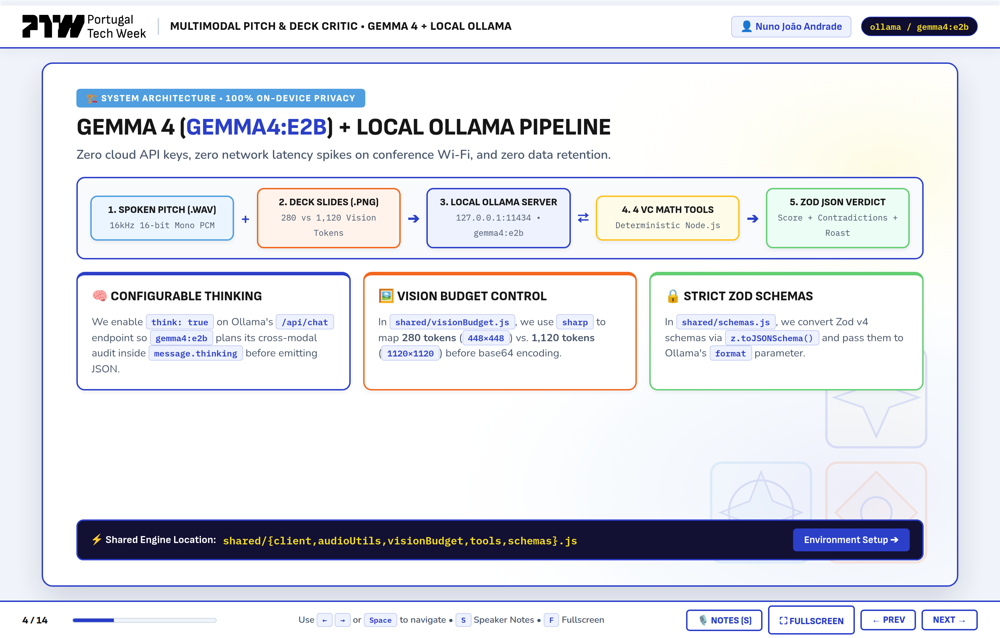

Let's walk through what happens at each layer of this architecture:
1. **Multimodal Input Normalization (`shared/audioUtils.js` & `shared/visionBudget.js`):**
   - Spoken pitch recordings are validated at the binary byte level to confirm a standard 44-byte RIFF/WAVE header (`16,000 Hz`, `16-bit`, `mono PCM`) or resampled in-browser via the Web Audio API (`OfflineAudioContext`) when recorded live from the user's microphone.
   - Slide images (`PNG`, `JPG`, `WEBP`) are resized using `sharp` to match the exact spatial resolution corresponding to their assigned Gemma 4 vision token budget: **`448×448` (`280 tokens`)** for layout/title slides, or **`1120×1120` (`1,120 tokens`)** for dense financial tables and 8pt footnotes.
2. **Stage 1 — Audio Narrative Arc Analysis (`step-02-narrative`):**
   - Evaluates the 5 canonical elevator pitch beats (**Problem**, **Solution**, **Traction**, **Business Model**, **The Ask**), estimates speaking pace in words per minute (`WPM`), counts filler words, and extracts structured `spokenClaims` so Stage 2 can audit them against the visual slides.
3. **Stage 2 — Cross-Modal Contradiction Detection (`step-03-contradictions`):**
   - Pairs the founder's `spokenClaims` and raw audio with the high-resolution `1,120`-token slide images to expose discrepancies across four categories: `GROWTH_METRIC`, `UNIT_ECONOMICS`, `BURN_MULTIPLE`, and `TAM_INFLATION`.
4. **Stage 3 — Multi-Turn VC Tool Loop & Final IC Verdict (`step-04-tools`):**
   - Rather than allowing the LLM to mentally approximate ratios, `gemma4:e2b` emits structured `tool_calls` for our 4 deterministic VC functions. Node.js executes the exact formulas, appends `role: 'tool'` messages back into the conversation history, and requests the final Zod-validated `InvestmentCommitteeVerdictSchema`.

---

## 3. Prerequisites & Zero-Key Local Setup (`Ollama` + `gemma4:e2b`)

Everything in this repository is designed to run on a standard developer laptop (macOS, Linux, or Windows WSL2) with **Node.js 20+** and **Ollama v0.20+**. In addition, for rapid CI testing or machines without a local GPU, the codebase includes a deterministic **Offline Mock Mode (`MOCK_OLLAMA=true`)** that exercises the exact same schemas, image pipelines, WAV header validators, and tool functions.

### Step 3.1: Install Ollama & Pull `gemma4:e2b`

```bash
# 1. Verify Ollama is installed and running
ollama --version

# 2. Pull Google's multimodal Gemma 4 model
ollama pull gemma4:e2b

# 3. Clone the workshop repository and install dependencies
git clone https://github.com/nuno-joao-andrade-dev/ptw_lisbon_2026.git
cd ptw_lisbon_2026
npm install
npm run build:ui

# 4. Run the 11-test automated verification suite
npm test
```

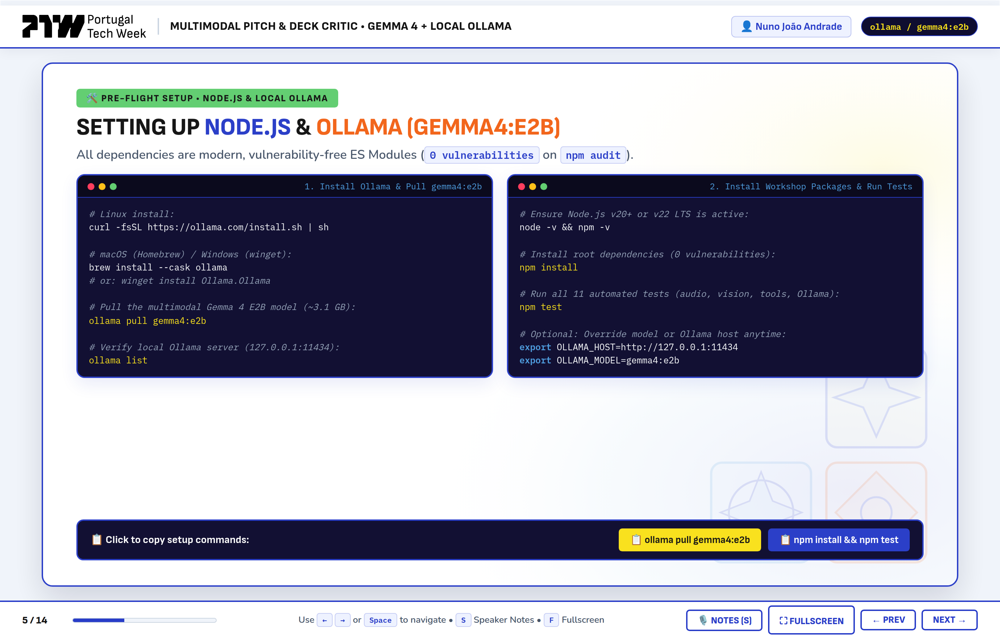

### Step 3.2: Inside `shared/config.js` — Central Runtime Configuration

To keep all five workshop steps clean and consistent, `shared/config.js` centralizes the Ollama host URL, model tag (`gemma4:e2b`), inference temperature (`0.2` for analytical consistency), and the two vision token budget presets (`280` and `1120`):

```javascript
// shared/config.js
import path from 'node:path';
import { fileURLToPath } from 'node:url';

const __dirname = path.dirname(fileURLToPath(import.meta.url));
export const ROOT_DIR = path.resolve(__dirname, '..');
export const FIXTURES_DIR = path.join(ROOT_DIR, 'fixtures');

export const CONFIG = {
  ollamaHost: process.env.OLLAMA_HOST || 'http://localhost:11434',
  model: process.env.OLLAMA_MODEL || 'gemma4:e2b',
  mockMode:
    process.env.MOCK_OLLAMA === 'true' ||
    process.env.MOCK_OLLAMA === '1',
  arenaPort: Number(process.env.PORT || 4000),
  temperature: 0.2,
  visionBudgets: {
    LOW_LAYOUT: 280,
    HIGH_DENSE_OCR: 1120
  }
};
```

### Step 3.3: Inside `shared/client.js` — Multimodal Ollama Client & `<think>` Parser

When `gemma4:e2b` runs with reasoning enabled (`think: true`), it can emit internal reasoning traces either via `message.thinking` or inline `<think>...</think>` blocks before the JSON payload. Our `shared/client.js` module handles:
1. Checking whether Ollama is reachable and `gemma4:e2b` is pulled (`checkOllamaStatus()`).
2. Stripping `<think>...</think>` tags and markdown fences cleanly before validating every response against a **Zod schema** (`parseJsonResponse()`).
3. Executing the **2-turn Ollama tool-calling loop** (`runToolAssistedVerdict()`), which we will inspect in detail in Step 4.

```javascript
// Excerpt from shared/client.js — Stripping <think> blocks & markdown fences before Zod validation
export function parseJsonResponse(rawContent, zodSchema = null) {
  if (!rawContent || typeof rawContent !== 'string') {
    throw new Error('Empty response content from model.');
  }

  // Strip <think>...</think> blocks if emitted inline
  let cleaned = rawContent.replace(/<think>[\s\S]*?<\/think>/gi, '').trim();

  // Strip ```json ... ``` markdown code fences
  const fenceMatch = cleaned.match(/```(?:json)?\s*([\s\S]*?)```/i);
  if (fenceMatch) {
    cleaned = fenceMatch[1].trim();
  }

  // Extract outermost JSON object
  const firstBrace = cleaned.indexOf('{');
  const lastBrace = cleaned.lastIndexOf('}');
  if (firstBrace !== -1 && lastBrace !== -1 && lastBrace > firstBrace) {
    cleaned = cleaned.slice(firstBrace, lastBrace + 1);
  }

  const parsed = JSON.parse(cleaned);
  if (zodSchema) {
    return zodSchema.parse(parsed);
  }
  return parsed;
}
```

---

## 4. The 90-Minute Workshop Roadmap & Synthetic Startup Fixtures

Rather than dumping attendees into a monolithic web app immediately, the repository is structured into **five self-contained, runnable folders** (`step-01-setup` through `step-05-arena`) plus a shared core library (`shared/`) and three realistic startup pitch fixtures (`fixtures/`):

```text
ptw_lisbon_2026/
├── shared/                      # Core multimodal utilities & Zod schemas
│   ├── config.js                # Ollama host, gemma4:e2b model & vision budget constants
│   ├── client.js                # Ollama API wrapper, <think> parser & 2-turn tool loop
│   ├── audioUtils.js            # 44-byte RIFF/WAVE PCM header parser & base64 loader
│   ├── visionBudget.js          # Sharp image resizer for 280 (448px) vs 1,120 (1120px) tokens
│   ├── tools.js                 # 4 deterministic VC functions + Ollama JSON tool schemas
│   └── schemas.js               # Zod schemas for Roast, Narrative, Contradictions & IC Verdict
├── fixtures/                    # Pre-generated 16kHz WAV audio & 1600×900 PNG slide decks
│   ├── manifest.json            # Metadata, spoken transcripts, slide OCR & metrics
│   ├── fixture_01_roast/        # "QuantumSynergy.ai" (AI Hype Overload — Score: 29/100)
│   ├── fixture_02_sprint/       # "CloudMetrics Pro" (Hidden 8pt Footnote Trap — Score: 34/100)
│   └── fixture_03_clean/        # "VeraGrid Energy" (Disciplined Climate-Tech — Score: 88/100)
├── step-01-setup/               # Step 1 (00–15m): 20-Second "Roast My Startup" Challenge
├── step-02-narrative/           # Step 2 (15–35m): Audio Narrative Arc & Vocal Delivery Critic
├── step-03-contradictions/      # Step 3 (35–55m): 280 vs 1,120 Vision Tokens & Contradictions
├── step-04-tools/               # Step 4 (55–75m): Multi-Turn Deterministic VC Tool Loop
├── step-05-arena/               # Step 5 (75–90m): Express SSE + Portugal Tech Week React 19 UI
└── slides/                      # Self-contained HTML/CSS Portugal Tech Week presentation deck
```

### The 3 Synthetic Startup Fixtures (`fixtures/manifest.json`)

Every attendee (and our automated test suite) gets three complete startup pitch packages in `fixtures/`, generated deterministically by `scripts/generate-fixtures.js` with real `16kHz 16-bit mono PCM WAV` files and `1600×900` PNG slides:

| Fixture ID | Startup Name & Tagline | The Pitch Trap / Profile | Expected IC Verdict |
| :--- | :--- | :--- | :--- |
| **`fixture_01_roast`** | **QuantumSynergy.ai**<br>*"Autonomous Agentic Blockchain Mesh for Hyper-Personalized B2B Workflows"* | **Buzzword Overload & Missing Unit Economics:** 11 hype buzzwords in 30 seconds (`quantum`, `synergy`, `agentic`, `web4`, `paradigm shift`), zero concrete pricing or CAC numbers, and asks for `$15M` at a `$150M` pre-money valuation on `$8k` MRR. | 🔴 **`HARD_PASS`**<br>(`29 / 100`) |
| **`fixture_02_sprint`** | **CloudMetrics Pro**<br>*"Predictive FinOps & Autonomous Kubernetes Cost Control"* | **The Hidden 8pt Footnote Contradiction:** Founder claims **25% MoM growth**, **4.8x LTV:CAC**, **1.0x burn multiple**, and a **$90B TAM** out loud. Slide #2's table + 8pt footnote reveal **9.1% MoM growth**, **$190k/mo excluded GPU COGS**, **3.50x actual burn multiple**, and a **$450M bottom-up TAM** (200× inflation). | 🔴 **`HARD_PASS`**<br>(`34 / 100`) |
| **`fixture_03_clean`** | **VeraGrid Energy**<br>*"Real-Time Grid-Edge Load Balancing for Industrial Heat Pumps"* | **Gold-Standard Disciplined Seed Pitch:** Zero buzzwords, crisp 3-column slides (`28–34` words/slide), and 100% alignment between spoken claims and visual tables (**18% MoM growth**, **78% gross margin**, **6.5x LTV:CAC**, **0.88x burn multiple**, and **$720M bottom-up TAM**). | 🟢 **`INVEST`**<br>(`88 / 100`) |

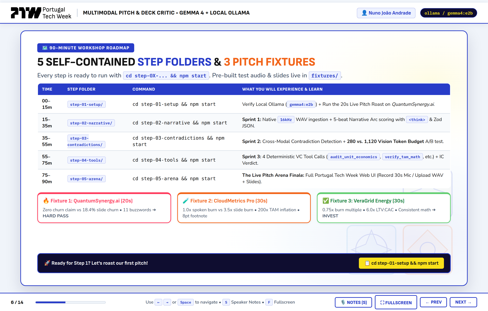

---

## 5. Step 1 (`step-01-setup`): The 20-Second "Roast My Startup" Challenge

> **▶️ Run Step 1:** `cd step-01-setup && npm start` (or `npm run step1` from the root directory)

In the first 15 minutes of the workshop, we verify our multimodal setup with immediate feedback: we feed **QuantumSynergy.ai** (`fixture_01_roast`)—both its `pitch_30s.wav` audio file and its `slide_01_title.png` slide—into `gemma4:e2b` in a single request and ask our ruthless VC partner persona to roast the pitch and validate the output with `RoastVerdictSchema`.

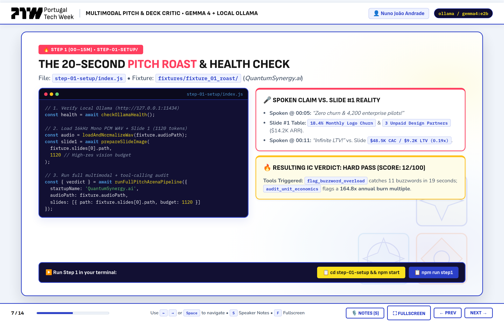

### Inside `step-01-setup/index.js`

Let's examine `step-01-setup/index.js`. Notice how cleanly it loads the WAV audio (`loadAudioInput`), processes Slide #1 with the `280`-token layout budget (`loadSlideWithBudget`), and validates the structured JSON output using `RoastVerdictSchema`:

```javascript
// step-01-setup/index.js
import path from 'node:path';
import { FIXTURES_DIR, CONFIG } from '../shared/config.js';
import { checkOllamaStatus, generateStructured } from '../shared/client.js';
import { loadAudioInput } from '../shared/audioUtils.js';
import { loadSlideWithBudget } from '../shared/visionBudget.js';
import { RoastVerdictSchema } from '../shared/schemas.js';

export async function runStep01() {
  const status = await checkOllamaStatus();
  const fixtureDir = path.join(FIXTURES_DIR, 'fixture_01_roast');
  const audioPath = path.join(fixtureDir, 'pitch_30s.wav');
  const slidePath = path.join(fixtureDir, 'slide_01_title.png');

  // 1. Validate 16kHz 16-bit mono WAV header and encode to base64
  const audioData = loadAudioInput(audioPath);
  // 2. Resize Slide #1 to 448x448 (280 Vision Tokens — Layout Mode)
  const slideData = await loadSlideWithBudget(slidePath, CONFIG.visionBudgets.LOW_LAYOUT);

  const systemPrompt = `You are a blunt, seasoned Silicon Valley & European Seed VC Partner.
Listen to the founder's 30-second elevator pitch audio and inspect their title slide image.
Deliver an immediate, witty, and brutally honest 20-second roast in JSON matching this exact schema:
{
  "startupName": "string",
  "roastHeadline": "string",
  "brutalRoast": "string (3-4 sentences calling out buzzwords, valuation delusion, or vagueness)",
  "buzzwordsDetected": ["string"],
  "clarityScore": 0-100,
  "instantVerdict": "HARD_PASS | DIG_DEEPER | INVEST"
}`;

  const userPrompt = `Startup Fixture: QuantumSynergy.ai (fixture_01_roast)
Audio Metadata: ${audioData.durationSeconds}s, ${audioData.sampleRate}Hz, ${audioData.channels}ch PCM WAV
Slide Vision Budget: ${slideData.tokenBudget} tokens (${slideData.targetDimension}x${slideData.targetDimension}px)
Return valid JSON only.`;

  const { parsed } = await generateStructured({
    systemPrompt,
    userPrompt,
    images: [slideData.base64],
    audioBase64: audioData.base64,
    zodSchema: RoastVerdictSchema,
    mockStepKey: 'step01_roast'
  });

  return parsed;
}
```

### What Step 1 Outputs in Your Terminal

Running `npm run step1` produces an instant `HARD_PASS` roast calling out QuantumSynergy.ai's buzzword salad:

```text
========================================================================
🔥 STEP 01: SETUP & "ROAST MY STARTUP" CHALLENGE (Gemma 4 + Ollama)
========================================================================
• Ollama Host : http://localhost:11434
• Model Tag   : gemma4:e2b
• Audio Input : pitch_30s.wav (30s, 16000Hz, 1ch)
• Slide Input : slide_01_title.png (Budget: 280 vision tokens / 448x448px)

🎤 ROAST VERDICT FOR: QuantumSynergy.ai
------------------------------------------------------------------------
Headline       : Buzzword Bingo Champion Seeking $150M for an API Wrapper
Clarity Score  : 22 / 100
Instant Verdict: HARD_PASS
Buzzwords Hit  : quantum, synergy, agentic, blockchain, hyper-dimensional, web4, paradigm shift

💬 Brutal VC Roast:
"You managed to cram 'quantum', 'agentic', 'blockchain', and 'Web4' into 30 seconds without
once explaining what a customer actually clicks or buys. Asking for $15M at a $150M valuation
on $8k of 'LOI-backed MRR' isn't a seed round—it's performance art."
========================================================================
```

---

## 6. Step 2 (`step-02-narrative`): Sprint 1 — Audio Narrative Arc & Vocal Delivery Critique

> **▶️ Run Step 2:** `cd step-02-narrative && npm start` (or `npm run step2` from the root directory)

Once our environment is verified, we move to our main case study startup for Sprints 1–3: **CloudMetrics Pro (`fixture_02_sprint`)**.

In **Step 2**, we focus on **native audio understanding**:
1. First, `shared/audioUtils.js` inspects the raw binary buffer of `pitch_30s.wav` to verify the 44-byte RIFF/WAVE PCM header (`RIFF`, `WAVE`, `fmt `, `audioFormat === 1` PCM, `16,000 Hz` sample rate, `16-bit` depth, `1` mono channel) and computes the exact duration in seconds.
2. Next, `step-02-narrative/index.js` sends the audio payload to `gemma4:e2b` to grade the **5 canonical elevator pitch beats** (`Problem`, `Solution`, `Traction`, `Business Model`, `The Ask`), estimate vocal pacing (`WPM`), count filler words (`um`, `uh`, `like`, `basically`), and extract the founder's explicit `spokenClaims` so we can cross-examine them against the slide deck in Step 3.

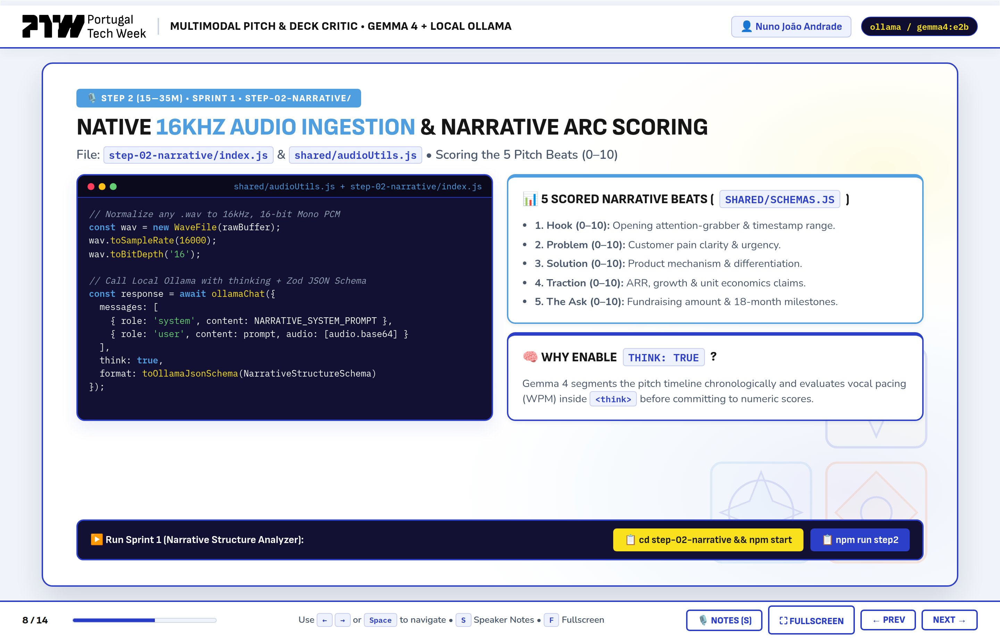

### Inside `shared/audioUtils.js` — Binary RIFF/WAVE Header Validation

Why validate the WAV header in Node.js before calling the model? Because audio bugs in workshops almost always trace back to corrupt recordings, stereo 48kHz containers, or empty buffers. Here is how `shared/audioUtils.js` parses the raw PCM header in pure JavaScript:

```javascript
// shared/audioUtils.js
export function validateWavHeader(buffer) {
  if (!Buffer.isBuffer(buffer) || buffer.length < 44) {
    return { valid: false, error: 'Buffer too small to contain a valid 44-byte WAV header.' };
  }

  const riff = buffer.toString('ascii', 0, 4);
  const wave = buffer.toString('ascii', 8, 12);
  if (riff !== 'RIFF' || wave !== 'WAVE') {
    return { valid: false, error: `Invalid RIFF/WAVE signature: got "${riff}/${wave}".` };
  }

  const audioFormat = buffer.readUInt16LE(20); // 1 = PCM
  const channels = buffer.readUInt16LE(22);
  const sampleRate = buffer.readUInt32LE(24);
  const byteRate = buffer.readUInt32LE(28);
  const bitsPerSample = buffer.readUInt16LE(34);

  const dataBytes = Math.max(0, buffer.length - 44);
  const durationSeconds = byteRate > 0 ? Number((dataBytes / byteRate).toFixed(2)) : 0;

  return {
    valid: audioFormat === 1,
    audioFormat,
    channels,
    sampleRate,
    bitsPerSample,
    byteRate,
    dataBytes,
    durationSeconds
  };
}
```

### What Step 2 Discovers About *CloudMetrics Pro*

When you run `npm run step2`, the Audio Narrative Critic scores *CloudMetrics Pro*'s spoken delivery at **81/100** (confident 162 WPM cadence, only 2 filler words), **but** it flags a critical omission in the narrative arc (`missingBeatWarning`) and extracts four bold spoken claims for Stage 2 to investigate:

```text
🎙️ STEP 02: SPRINT 1 — AUDIO NARRATIVE ARC & DELIVERY CRITIC
------------------------------------------------------------------------
• Pacing Estimate   : 162 WPM (Target: 130–160 WPM)
• Filler Word Count : 2
• Vocal Confidence  : 84 / 100
• Narrative Score   : 81 / 100
• ⚠️ Missing Beat   : Founder never states gross margin or AWS GPU infrastructure
                      COGS in the spoken pitch despite claiming an AI FinOps platform.

📌 Extracted Spoken Claims (Passed to Step 3 Cross-Modal Contradiction Detector):
  1. "We are growing 25% month-over-month at $240,000 MRR"
  2. "Our LTV to CAC ratio is 4.8x"
  3. "Our net burn multiple is a lean 1.0x"
  4. "We are tackling a $90 billion bottom-up TAM"
```

---

## 7. Step 3 (`step-03-contradictions`): Sprint 2 — Variable Vision Token Budgets (`280` vs. `1,120`) & Cross-Modal Contradictions

> **▶️ Run Step 3:** `cd step-03-contradictions && npm start` (or `npm run step3` from the root directory)

Now we reach one of the most important architectural concepts in multimodal AI engineering: **right-sizing your vision token budget per image**.

### Why Variable Vision Token Budgets Matter (`280` vs. `1,120` Tokens)

In Gemma 4's vision encoder, image inputs are tiled into patches where spatial resolution directly controls how many vision tokens are consumed in the model's context window:
- **280 Vision Tokens (`448×448 px` — `LOW_280_LAYOUT`):**
  - **Ideal for:** Title slides, big-font value propositions, and 3-bullet summary slides (`Slide #1`).
  - **Advantage:** ~4× faster prefill latency and minimal KV-cache memory footprint on laptop GPUs/CPUs.
  - **Limitation:** Small 8-point footnotes at the bottom of a financial table blur below the OCR legibility threshold!
- **1,120 Vision Tokens (`1120×1120 px` — `HIGH_1120_DENSE_OCR`):**
  - **Ideal for:** Multi-column financial tables, cohort retention charts, and dense architecture diagrams (`Slide #2` and `Slide #3`).
  - **Advantage:** Preserves crisp character edges on 8pt fine print—allowing `gemma4:e2b` to read the hidden disclaimer at the bottom of *CloudMetrics Pro*'s financial slide:
    > *"*Footnote: Spoken pitch figures exclude $190k/mo AWS GPU cluster costs and 4.2% monthly logo churn."*

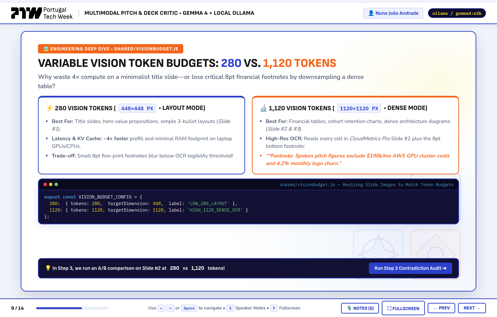

### Inside `shared/visionBudget.js` — Resizing Slide Images with `sharp`

Let's look at `shared/visionBudget.js`, which enforces our `280` vs. `1,120` vision token budgets by resizing each slide image with `sharp` (`fit: 'inside'`) before encoding it to base64 for Ollama:

```javascript
// shared/visionBudget.js
import fs from 'node:fs';
import sharp from 'sharp';

export const VISION_BUDGET_CONFIG = {
  280: {
    tokens: 280,
    targetDimension: 448,
    label: 'LOW_280_LAYOUT',
    description: 'Fast layout & headline inspection (448x448 max bounding box, ~280 vision tokens)'
  },
  1120: {
    tokens: 1120,
    targetDimension: 1120,
    label: 'HIGH_1120_DENSE_OCR',
    description: 'High-resolution dense table & 8pt footnote OCR (1120x1120 max bounding box, ~1,120 vision tokens)'
  }
};

export async function loadSlideWithBudget(imageInput, budgetTokens = 280) {
  const budget = VISION_BUDGET_CONFIG[budgetTokens] || VISION_BUDGET_CONFIG[280];
  const rawBuffer = Buffer.isBuffer(imageInput) ? imageInput : fs.readFileSync(imageInput);

  const metadata = await sharp(rawBuffer).metadata();
  const resizedBuffer = await sharp(rawBuffer)
    .resize(budget.targetDimension, budget.targetDimension, {
      fit: 'inside',
      withoutEnlargement: false
    })
    .png({ compressionLevel: 8 })
    .toBuffer();

  return {
    tokenBudget: budget.tokens,
    budgetLabel: budget.label,
    targetDimension: budget.targetDimension,
    originalWidth: metadata.width || 1600,
    originalHeight: metadata.height || 900,
    processedBytes: resizedBuffer.length,
    base64: resizedBuffer.toString('base64')
  };
}
```

### Running the A/B Vision Budget Comparison & Contradiction Audit in `step-03-contradictions/index.js`

In `step-03-contradictions/index.js`, we process *CloudMetrics Pro*'s Slide #2 (`slide_02_financials.png`) at **both** `280` tokens and `1,120` tokens, and then feed the `280`-token Slide #1 + `1,120`-token Slides #2 and #3 alongside the founder's spoken claims into `gemma4:e2b` using `ContradictionReportSchema`:

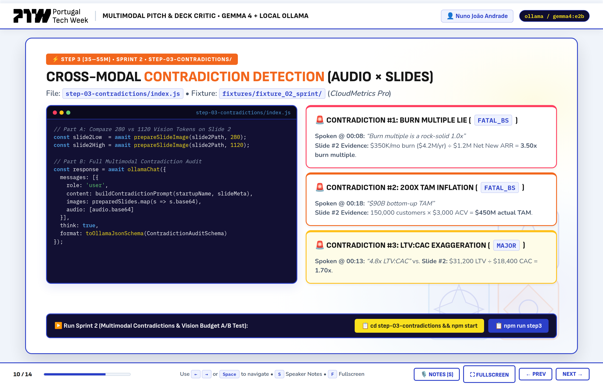

Here are the **4 cross-modal contradictions** caught automatically by Step 3:

| Severity | Category | Slide # | What the Founder Said (Audio) | What the Slide Actually Shows (`1,120` Vision Tokens) |
| :--- | :--- | :---: | :--- | :--- |
| 🔴 **`CRITICAL`** | **`GROWTH_METRIC`** | Slide #2 | *"We are growing 25% month-over-month at $240k MRR."* | Table shows MRR grew from `$200k` (Aug) ➔ `$220k` (Sep) ➔ **`$240k` (Oct)**, which is **9.1% MoM** (`+$20k / $220k`), not 25%. |
| 🔴 **`CRITICAL`** | **`UNIT_ECONOMICS`** | Slide #2 | *"Our LTV-to-CAC ratio is an elite 4.8x."* | The **8pt bottom footnote** reveals spoken metrics exclude **`$190k/mo` AWS GPU cluster COGS** and **4.2% monthly logo churn** (real gross margin is **20.8%**, dropping true LTV:CAC to **~1.7x**). |
| 🔴 **`CRITICAL`** | **`BURN_MULTIPLE`** | Slide #2 | *"Our net burn multiple is a lean 1.0x."* | Slide #2 reports **`$140k/mo` Net Cash Burn** against `$20k` net new MRR (`$40k` annualized net new ARR pace) = **3.50x Burn Multiple**. |
| 🟠 **`HIGH`** | **`TAM_INFLATION`** | Slide #3 | *"We are addressing a $90B bottom-up TAM."* | Slide #3 lists **`15,000` target ICP accounts** at **`$30,000` ACV**, which equals a **`$450M` bottom-up TAM** (a **200×** top-down exaggeration). |

---

## 8. Step 4 (`step-04-tools`): Sprint 3 — Deterministic VC Tool Calling & Final IC Verdict

> **▶️ Run Step 4:** `cd step-04-tools && npm start` (or `npm run step4` from the root directory)

Catching visual contradictions is huge—but what about exact financial verification?

Even the best language models should never be trusted to compute financial ratios like `LTV / CAC`, `Gross Margin %`, or `Net Burn / Net New ARR` via next-token prediction. If a founder's pitch deck states `MRR = $240k`, `COGS = $190k`, `CAC = $18,000`, `Monthly Churn = 4.2%`, `Net Burn = $140k`, and `Net New ARR = $40k`, we want **deterministic code** to compute the exact numbers and VC benchmark grades before the model writes its final Investment Committee verdict.

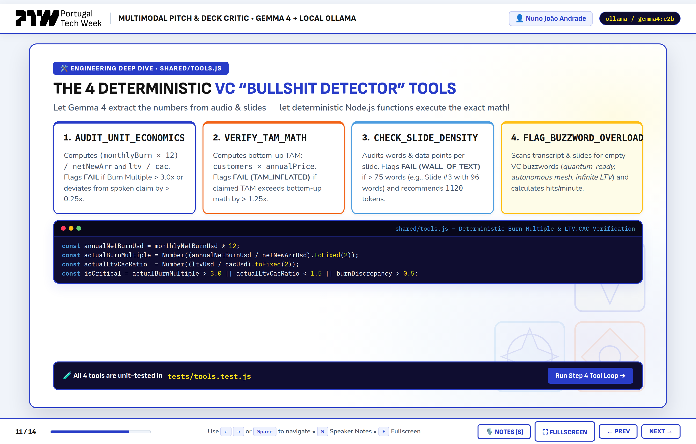

### The 4 Deterministic VC Tools in `shared/tools.js`

In `shared/tools.js`, we define both the **pure Node.js mathematical implementations** and the **Ollama JSON Schema tool definitions (`OLLAMA_VC_TOOLS`)** for four specialized Venture Capital audit tools:

1. **`audit_unit_economics({ mrr, cogs, cac, monthlyChurnPct, netBurn, netNewArr })`:**
   - Computes exact **Gross Margin %** (`(mrr - cogs) / mrr`), **Customer Lifetime Months** (`1 / (monthlyChurnPct / 100)`), **LTV** (`ARPU_Gross_Margin × Lifetime`), **LTV:CAC Ratio**, and **Burn Multiple** (`netBurn / netNewArr`).
   - Flags `CRITICAL_BURN_INEFFICIENCY` (`> 2.5x`), `UNPROFITABLE_ACQUISITION` (`LTV:CAC < 3.0x`), and `LOW_SOFTWARE_MARGIN` (`< 50%`).
2. **`verify_tam_math({ claimedTamUsd, icpCount, acvUsd })`:**
   - Multiplies `icpCount × acvUsd` to calculate the true **Bottom-Up TAM** and computes the `inflationMultiplier` (`claimedTamUsd / bottomUpTamUsd`). Flags `SEVERE_TAM_BLOAT` if inflated by more than `10×`.
3. **`check_slide_density({ slideNumber, wordCount, pitchDurationSeconds })`:**
   - Audits slide word count against the **45-word demo-day limit** (`WALL_OF_TEXT` if `> 75` words) and calculates how many seconds an investor would need to silently read the slide at 200 WPM.
4. **`flag_buzzword_overload({ transcript, buzzwords })`:**
   - Scans the spoken transcript against a 16-term hype dictionary (`quantum`, `synergy`, `agentic`, `blockchain`, `web4`, `paradigm shift`, `hyper-dimensional`, etc.) and grades density (`PASS` / `WARNING` / `FAIL`).

```javascript
// Excerpt from shared/tools.js — Deterministic Unit Economics Auditor
export function auditUnitEconomics({
  mrr,
  cogs,
  cac,
  monthlyChurnPct,
  netBurn,
  netNewArr,
  activeCustomers = 160
}) {
  const grossProfit = mrr - cogs;
  const grossMarginPct = mrr > 0 ? Number(((grossProfit / mrr) * 100).toFixed(1)) : 0;

  const arpu = activeCustomers > 0 ? mrr / activeCustomers : 1500;
  const grossMarginDecimal = Math.max(0, grossMarginPct / 100);
  const churnDecimal = Math.max(0.005, monthlyChurnPct / 100);

  const ltv = (arpu * grossMarginDecimal) / churnDecimal;
  const ltvCacRatio = cac > 0 ? Number((ltv / cac).toFixed(2)) : 0;
  const burnMultiple = netNewArr > 0 ? Number((netBurn / netNewArr).toFixed(2)) : 99.9;

  const flags = [];
  if (grossMarginPct < 50) flags.push(`LOW_SOFTWARE_MARGIN (${grossMarginPct}% < 70% SaaS benchmark)`);
  if (ltvCacRatio < 3.0) flags.push(`WEAK_LTV_CAC (${ltvCacRatio}x < 3.0x benchmark)`);
  if (burnMultiple > 2.5) flags.push(`CRITICAL_BURN_INEFFICIENCY (${burnMultiple}x > 2.0x benchmark)`);

  return {
    tool: 'audit_unit_economics',
    grossMarginPct,
    computedLtvUsd: Math.round(ltv),
    ltvCacRatio,
    burnMultiple,
    vcGrade: flags.length === 0 ? 'INSTITUTIONAL_GRADE' : flags.length >= 2 ? 'FAIL' : 'WARNING',
    flags
  };
}
```

### How the 2-Turn Ollama Tool-Calling Loop Works (`shared/client.js` & `step-04-tools/index.js`)

Here is the exact sequence diagram showing how `runToolAssistedVerdict()` orchestrates the 2-turn conversation between Node.js and `gemma4:e2b`:

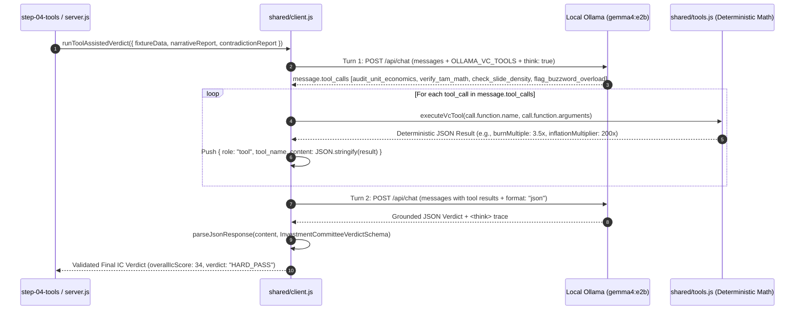

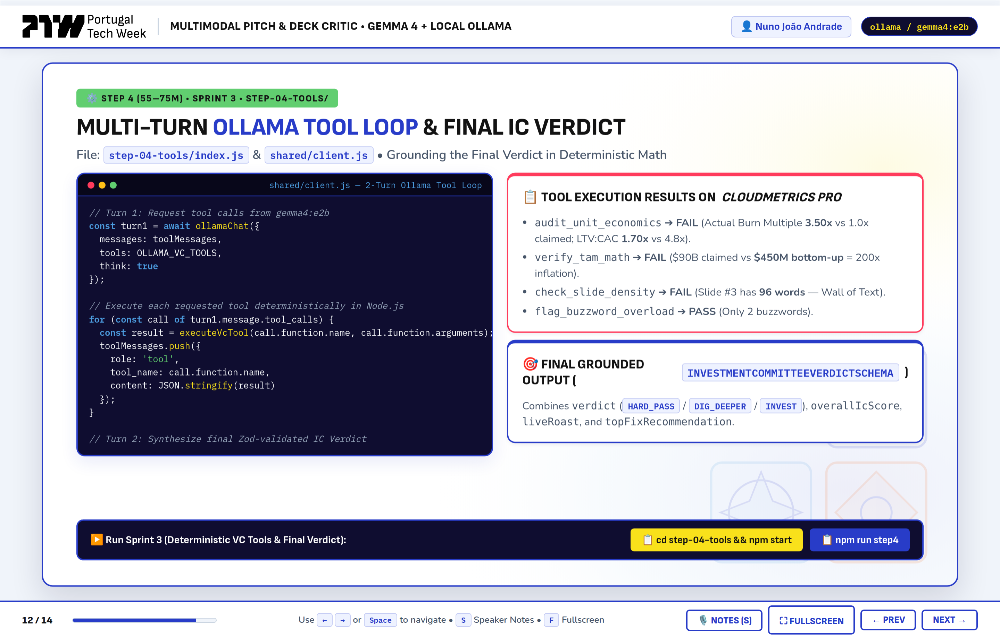

When you run `cd step-04-tools && npm start`, you can watch Turn 1 invoke all 4 tools on *CloudMetrics Pro*, inspect the exact JSON payloads returned by `shared/tools.js`, and read the final grounded Investment Committee Memo (`overallIcScore: 34 / 100`, `verdict: "HARD_PASS"`).

---

## 9. Step 5 (`step-05-arena`): The Live Portugal Tech Week Pitch Arena Web Application

> **▶️ Launch Step 5 (Full-Stack Web Arena):**
> ```bash
> cd step-05-arena && npm start
> # Express SSE API Server starts on http://localhost:4000
> # Portugal Tech Week React 19 UI opens at http://localhost:5173
> # Interactive Workshop Slides served at http://localhost:4000/slides
> ```

In our final 15-minute sprint, we bring the entire 3-stage multimodal pipeline to life inside a clean, responsive web application styled after the official **Portugal Tech Week (`portugaltechweek.com`)** brand system:
- **Official Portugal Tech Week Palette:** PTW Royal Blue (`#2139BA`), PTW Deep Navy (`#0B1258`), PTW Coral Orange (`#EC651B`), PTW Golden Yellow (`#FAD02C`), and PTW Sky Blue (`#5099D4`) over a crisp white card canvas with custom Portuguese Azulejo geometric SVG watermarks.
- **Built-In Workshop Disclaimer Modal (`WorkshopDisclaimerModal.jsx`):** On launch (and anytime via the top header's **`⚠️ Workshop Disclaimer`** pill), a Portugal Tech Week-styled modal clearly states:
  > *"This application is an educational workshop built for Portugal Tech Week 2026 and is **just a guide to better pitch your project — this isn't the real result**."*

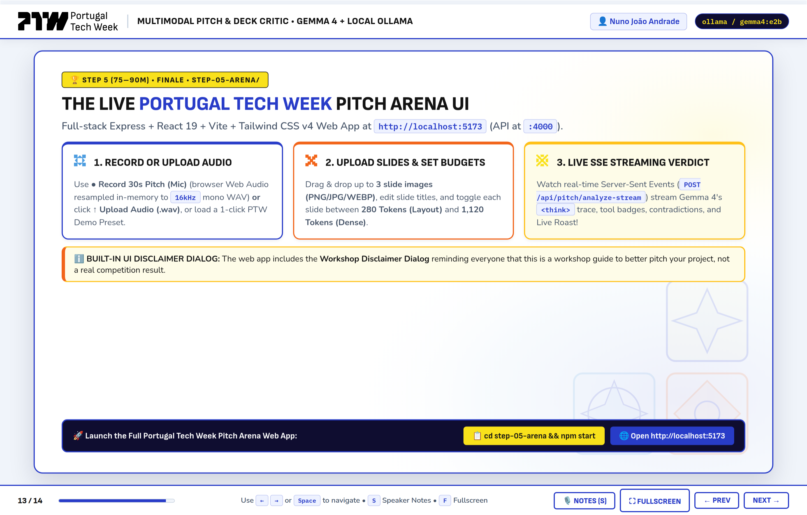

### Key Capabilities of the Pitch Arena UI (`step-05-arena/`)

1. **Three 1-Click Portugal Tech Week Demo Presets:**
   - Instantly load **QuantumSynergy.ai (`fixture_01_roast`)**, **CloudMetrics Pro (`fixture_02_sprint`)**, or **VeraGrid Energy (`fixture_03_clean`)**—complete with playable 30-second WAV audio and 3 slide previews—to compare a `29/100 HARD_PASS`, a `34/100 HARD_PASS`, and an `88/100 INVEST` pitch side by side.
2. **Record a Live 30-Second Pitch from Your Microphone (`audioResampler.js`):**
   - Click **`● Record 30s Pitch (Mic)`** to capture live microphone audio in the browser. When you stop recording, `step-05-arena/client/src/utils/audioResampler.js` uses the browser's `OfflineAudioContext` to resample the audio in-memory into a genuine **`16,000 Hz`, `16-bit`, mono RIFF/WAVE PCM** file ready for `gemma4:e2b`—or click **`↑ Upload Audio (.wav)`** to upload a pre-recorded file.
3. **Upload Custom Slide Decks & Toggle Per-Slide Vision Token Budgets (`280` vs. `1,120` Tokens):**
   - Drag and drop up to **3 slide images (`PNG`, `JPG`, `WEBP`)**, customize each slide's title, and toggle each individual slide between **`280 Tokens (Layout)`** (`448×448`) and **`1,120 Tokens (Dense)`** (`1120×1120`) while watching the live **Total Vision Token Budget Meter** update in the header.
4. **Real-Time Server-Sent Events (`POST /api/pitch/analyze-stream`):**
   - Clicking **`⚡ Run Full Multimodal IC Audit`** opens a streaming SSE connection to `step-05-arena/server.js`, updating the 4 pipeline progress pills (`1. Audio & Vision Ingest` ➔ `2. Narrative & Contradictions` ➔ `3. VC Tool Verification` ➔ `4. Final IC Verdict`), streaming Gemma 4's `<think>` reasoning trace, rendering interactive VC tool execution cards, and unveiling the final **Investment Committee Verdict Banner**, **Cross-Modal Contradiction Cards**, and **Priority Actionable Fix**.

---

## 10. Workshop Command Cheat Sheet, Troubleshooting & Key Takeaways

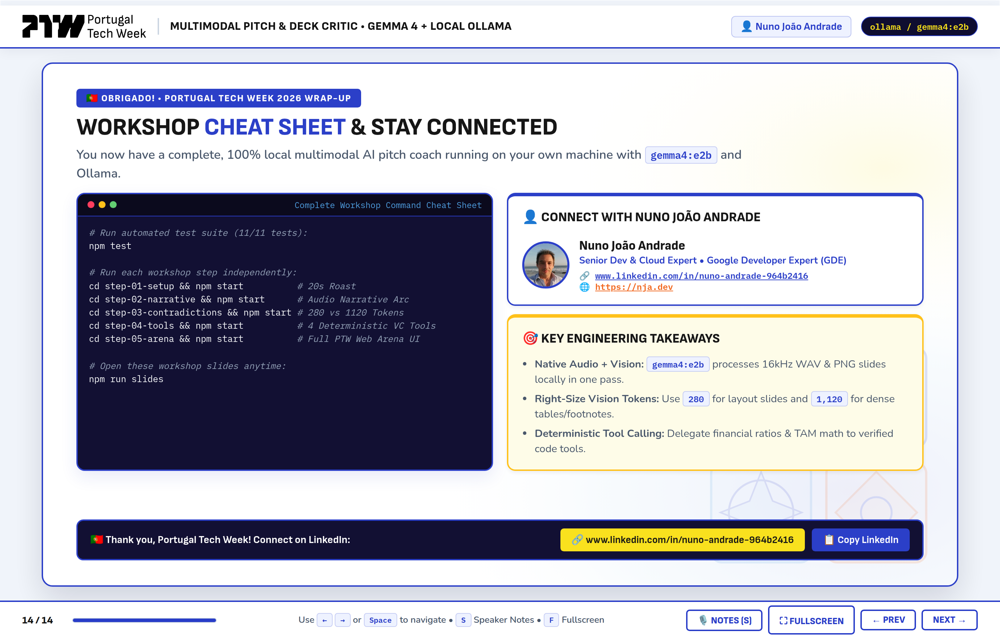

### Complete Command Reference

```bash
# 1. Run the automated verification suite (11/11 tests across all steps & REST endpoints)
npm test

# 2. Run each progressive workshop step from the repository root (or cd into each folder):
npm run step1    # or: cd step-01-setup && npm start          (20-Second Startup Roast)
npm run step2    # or: cd step-02-narrative && npm start      (Audio Narrative Arc Critic)
npm run step3    # or: cd step-03-contradictions && npm start (280 vs 1,120 Vision Tokens)
npm run step4    # or: cd step-04-tools && npm start          (4 Deterministic VC Tools + Verdict)
npm run step5    # or: cd step-05-arena && npm start          (Full Portugal Tech Week Web Arena)

# 3. Open the 14-slide interactive Portugal Tech Week presentation deck:
npm run slides   # Serves slides/index.html at http://localhost:3050

# 4. Run any step in deterministic Offline Mock Mode (no GPU / Ollama required):
MOCK_OLLAMA=true npm run step4
```

### Troubleshooting Common Workshop Issues

| Symptom | Root Cause | Quick Fix |
| :--- | :--- | :--- |
| `Connection refused` on `http://localhost:11434` | Local Ollama daemon is not running, or laptop lacks RAM/VRAM during live workshop. | Start Ollama with `ollama serve`, or prefix any command with `MOCK_OLLAMA=true` (automatic fallback is also built into `shared/client.js`). |
| Model misses the 8pt footnote on Slide #2 (`slide_02_financials.png`) | Slide #2 was resized with the `280`-token (`448×448`) layout budget instead of `1,120` tokens. | Switch Slide #2 to **`1,120 Tokens (Dense)`** (`1120×1120`) in the UI or pass `CONFIG.visionBudgets.HIGH_DENSE_OCR` (`1120`) to `loadSlideWithBudget()`. |
| `JSON.parse` fails on raw model output | `gemma4:e2b` emitted `<think>...</think>` blocks or ` ```json ` markdown fences around the JSON object. | Always pass raw responses through `parseJsonResponse(rawContent, zodSchema)` in `shared/client.js`. |
| Browser microphone button is disabled or fails | Browser blocked `navigator.mediaDevices.getUserMedia` or page wasn't accessed via `localhost`. | Access the UI via `http://localhost:5173` (or `:4000`), grant mic permission, or use **`↑ Upload Audio (.wav)`** with any file in `fixtures/`. |

---

## Summary: 4 Architectural Patterns to Take Back to Your Engineering Team

1. **Eliminate Brittle ASR Cascades When Native Audio Is Available:** By passing `16kHz 16-bit mono PCM WAV` audio directly to a multimodal model like `gemma4:e2b`, your application retains vocal pacing, hesitation cues, and cross-modal grounding without managing a separate Whisper service.
2. **Treat Vision Tokens Like a FinOps Budget (`280` vs. `1,120`):** Never use a single static image resolution for an entire document deck. Use `280` tokens (`448×448`) for low-density title/layout slides and reserve `1,120` tokens (`1120×1120`) for dense tables and fine-print footnotes.
3. **Never Let an LLM Do Unchecked Financial Arithmetic:** Pair multimodal perception with deterministic function calling (`audit_unit_economics`, `verify_tam_math`, `check_slide_density`, `flag_buzzword_overload`) so every ratio in the final report is mathematically verified.
4. **Enforce Schemas at the Boundary with Zod:** Stripping `<think>` traces and validating every stage output against strict Zod schemas (`RoastVerdictSchema`, `NarrativeCritiqueSchema`, `ContradictionReportSchema`, `InvestmentCommitteeVerdictSchema`) turns probabilistic model outputs into rock-solid API contracts that a React frontend can render with confidence.

---

*Thank you for joining this **Portugal Tech Week 2026** workshop! Feel free to connect with me on LinkedIn at [www.linkedin.com/in/nuno-andrade-964b2416](https://www.linkedin.com/in/nuno-andrade-964b2416) and explore more articles at [nja.dev](https://nja.dev).*
