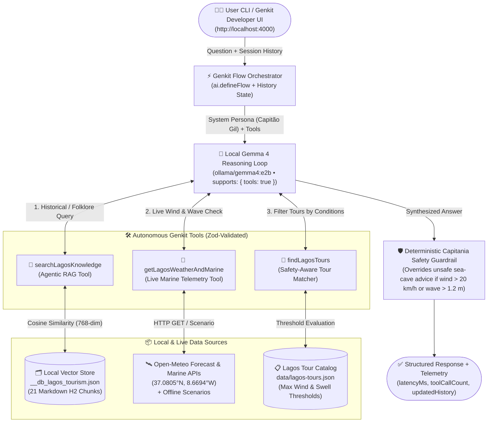
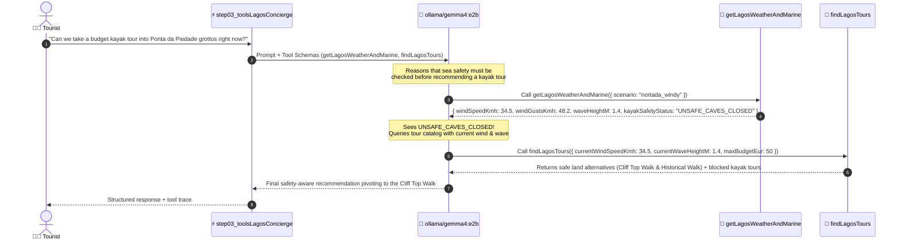

> **Workshop GitHub Repository**: [https://github.com/nuno-joao-andrade-dev/devfest_lagos_2026/](https://github.com/nuno-joao-andrade-dev/devfest_lagos_2026/)
> **Interactive Presentation Slides**: [https://nuno-joao-andrade-dev.github.io/devfest_lagos_2026/slides/](https://nuno-joao-andrade-dev.github.io/devfest_lagos_2026/slides/) ([Source in Repo](https://github.com/nuno-joao-andrade-dev/devfest_lagos_2026/tree/main/slides))
>
> ```bash
> git clone https://github.com/nuno-joao-andrade-dev/devfest_lagos_2026.git
> cd devfest_lagos_2026
> npm install
> ```

> **Special Thanks**: A special thank you to **GDG Lagos** and the **DevFest Lagos 2026** organizing team for the warm invitation, organization, and support in making this hands-on session in the Algarve possible!

At **DevFest Lagos 2026** in the coastal heart of the Algarve, Portugal, we explored one of the most practical shifts in modern AI engineering: **moving from cloud-dependent static prompts to 100% local, autonomous Agentic RAG systems in TypeScript**.

Using **Google's Gemma 4 (`gemma4:e2b`)** running locally on **Ollama** and orchestrated by the **Google Genkit TypeScript SDK**, we built **Capitão Gil**—an autonomous coastal concierge for **Lagos and the Ponta da Piedade sea caves** (`37.0805° N, 8.6694° W`). Over five progressive architectural milestones, our agent evolved from a hallucinating static prompt into a production-ready local system capable of querying a local vector store for 1913 maritime history, checking live Atlantic swell and *Nortada* wind gusts via Open-Meteo marine APIs, enforcing deterministic sea-cave safety rules, and maintaining multi-turn conversational memory—all with **zero cloud API keys and zero per-token billing**.


> [!NOTE]
> **Key Architectural Goal:** Instead of hardcoding a rigid vector lookup before every LLM call (**Static RAG**), we equip a compact local model (`ollama/gemma4:e2b`) with strongly-typed **Genkit Tools**—turning vector retrieval (`searchLagosKnowledge`), live marine meteorology (`getLagosWeatherAndMarine`), and safety-filtered tour discovery (`findLagosTours`) into autonomous actions that the model plans and chains on demand (**Agentic RAG**).

---

## Why Static Prompts Fail on the Algarve Coast

Ask an ungrounded language model *"Why was the 1913 Ponta da Piedade lighthouse delayed, and is it safe to take a kayak into the 'A Cozinha' grotto right now?"* and you immediately hit three fundamental walls:

1. **Private & Hyper-Local Knowledge Blindness:** Pre-trained weights do not know hyper-local archive details (such as the 1910–1913 parish land dispute over the **Ermida de Nossa Senhora da Piedade** ruins), curated local folklore, or private event facts (like the DevFest Lagos 2026 secret passphrase).
2. **Real-Time Environmental Blindness:** In Lagos, calm morning waters (`12 km/h` wind, `0.4 m` swell) frequently transform after 14:00 into hazardous **Nortada** offshore gusts (`34+ km/h`) or `2.1 m` Atlantic groundswells. A static prompt cannot see current ocean telemetry and will cheerfully recommend paddling into limestone arches that the **Capitania do Porto de Lagos** has closed.
3. **Rigid Execution:** Without tool-calling orchestration, a static prompt cannot decide when to query a document index, when to call a weather sensor API, or how to pivot to a safe land-based cliff boardwalk tour when the sea caves are closed.


---

## The AI Agent Paradigm Shift: Cloud vs. Local-First

Running **Gemma 4 (`gemma4:e2b`)** locally via **Ollama** inside **Google Genkit** changes the economics, privacy posture, and developer experience of building agentic applications:

| Architectural Dimension | Traditional Cloud-Only Agent | Local-First Edge Agent (`Gemma 4 + Genkit + Ollama`) |
| :--- | :--- | :--- |
| **Inference Runtime** | Remote multi-tenant cloud endpoints | **100% On-Device** (`http://127.0.0.1:11434` via Ollama) |
| **Data Privacy & GDPR** | User prompts & RAG chunks traverse external networks | **Zero data egress**; private documents & chat history never leave the machine |
| **API Keys & Billing** | Requires cloud billing accounts, quotas & per-token fees | **$0.00 / token**; zero API keys required (`OLLAMA_HOST` local loopback) |
| **Offline Resilience** | Fails immediately when conference Wi-Fi drops | **Works offline** with local vector store (`__db_lagos_tourism.json`) & fallback weather scenarios |
| **Tool & RAG Orchestration** | Often coupled to proprietary SDKs | **Unified Google Genkit SDK** (`ai.defineFlow`, `ai.defineTool`, `ai.retrieve`, Zod schemas) |
| **Cloud Portability** | Vendor-locked | Swap `ollama/gemma4:e2b` for Vertex AI / Gemini in one config line (`src/config/genkit.ts`) |

---

## System Architecture Blueprint

The diagram below illustrates the complete end-to-end runtime architecture we build across the workshop, culminating in **Step 05**:



### Architectural Highlights

- **Single Shared Genkit Configuration (`src/config/genkit.ts`):** Registers the `genkitx-ollama` plugin pointing to `http://127.0.0.1:11434` and explicitly enables `supports: { tools: true }` on `gemma4:e2b` so Genkit unlocks multi-turn function calling.
- **Resilient Local Vector Store (`@genkit-ai/dev-local-vectorstore`):** Indexes 21 semantically chunked Markdown sections from `data/lagos-knowledge/*.md` into `__db_lagos_tourism.json` using a deterministic 768-dimensional local embedding pipeline that requires zero cloud API keys.
- **Live + Deterministic Maritime Telemetry (`src/lib/weather-service.ts`):** Queries real-time Open-Meteo Forecast and Marine APIs for exact Ponta da Piedade coordinates (`37.0805° N, 8.6694° W`), while supporting deterministic workshop simulation presets (`calm`, `nortada_windy`, `atlantic_swell`).
- **Defense-in-Depth Safety Guardrail (`step-05-production-agent/index.ts`):** Even when an LLM has access to accurate weather tools, production systems never rely solely on probabilistic text generation for physical safety. Step 05 cross-checks the model's final answer against the sensor's `UNSAFE_CAVES_CLOSED` verdict.

---

## 5-Step Progressive Curriculum Roadmap

The repository is structured into **five self-contained, runnable milestones**. Each step builds directly on the previous one and can be executed from the terminal or inspected visually in the **Genkit Developer UI** (`http://localhost:4000`).


| Step | Directory | Architectural Milestone | Key Genkit Primitives | Terminal & UI Commands |
| :--- | :--- | :--- | :--- | :--- |
| **Step 01** | `step-01-basic-prompt/` | Static Prompt Baseline & Type-Safe Schemas | `ai.defineFlow`, `ai.generate`, Zod `output.schema` | `npm run step 1` |
| **Step 02** | `step-02-vector-rag/` | Local Vector Store Indexing & Static RAG | `ai.index`, `ai.retrieve`, `Document.fromText` | `npm run step 2`<br/>`npm run step 2 ui` |
| **Step 03** | `step-03-custom-tools/` | Live Open-Meteo Weather & Tour Filtering Tools | `ai.defineTool`, multi-tool `tools: [...]` array | `npm run step 3`<br/>`npm run step 3 -- nortada_windy` |
| **Step 04** | `step-04-agentic-rag/` | Autonomous Agentic RAG (`searchLagosKnowledge`) | Retriever wrapped inside `ai.defineTool` | `npm run step 4`<br/>`npm run step 4 ui` |
| **Step 05** | `step-05-production-agent/` | Multi-Turn Memory, Guardrails & Telemetry | Session `history`, safety guardrail, interactive CLI | `npm run step 5`<br/>`npm run step 5 -- interactive` |

### Quick-Start Commands

```bash
# 1. Clone the workshop repository and install dependencies
git clone https://github.com/nuno-joao-andrade-dev/devfest_lagos_2026.git
cd devfest_lagos_2026
npm install

# 2. Pull the local Gemma 4 model via Ollama
ollama pull gemma4:e2b

# 3. Run the automated pre-flight verification suite
npm run verify
```

---

## Prerequisites & Foundation: Node.js, Ollama & `src/config/genkit.ts`

Before running Step 01, we configure two local building blocks: **Node.js v20+ LTS** (with TypeScript executed directly via `tsx`) and **Ollama** serving `gemma4:e2b` on `127.0.0.1:11434`.


### Configuring Genkit + Local `gemma4:e2b` (`src/config/genkit.ts`)

All five workshop steps import their shared Genkit instance `ai` from `src/config/genkit.ts`. Two engineering details in this file are essential for reliable local agent execution:

1. **`supports: { tools: true }` on `gemma4:e2b`:** By default, many local model definitions in `genkitx-ollama` do not advertise tool-calling capability to Genkit's runtime validator. Explicitly passing `supports: { tools: true }` unlocks `ai.defineTool()` orchestration in Steps 03–05.
2. **Zero-Dependency Local 768-Dim Embedder (`lagosLocalEmbedder`):** To ensure `@genkit-ai/dev-local-vectorstore` works out-of-the-box with only `ollama pull gemma4:e2b` (and zero external cloud embedding keys or extra model downloads), `src/config/genkit.ts` defines a deterministic 768-dimensional character/word n-gram feature-hashing embedder (`computeLocal768Embedding`) with L2 normalization.


```typescript
// src/config/genkit.ts
import { genkit, z } from 'genkit';
import { ollama } from 'genkitx-ollama';
import {
  devLocalVectorstore,
  devLocalIndexerRef,
  devLocalRetrieverRef,
} from '@genkit-ai/dev-local-vectorstore';

export const OLLAMA_SERVER_ADDRESS =
  process.env.OLLAMA_HOST || 'http://127.0.0.1:11434';

export const GEMMA_MODEL_NAME = process.env.GEMMA_MODEL || 'gemma4:e2b';
export const GEMMA_MODEL = `ollama/${GEMMA_MODEL_NAME}`;
export const LAGOS_VECTOR_INDEX_NAME = 'lagos_tourism';

export const ai = genkit({
  plugins: [
    ollama({
      serverAddress: OLLAMA_SERVER_ADDRESS,
      models: [
        {
          name: GEMMA_MODEL_NAME,
          type: 'chat',
          // CRITICAL: Explicitly unlock native tool/function calling for gemma4:e2b
          supports: {
            tools: true,
          },
        },
      ],
    }),
    devLocalVectorstore([
      {
        indexName: LAGOS_VECTOR_INDEX_NAME,
        embedder: 'lagosLocalEmbedder',
      },
    ]),
  ],
});

export const lagosIndexer = devLocalIndexerRef(LAGOS_VECTOR_INDEX_NAME);
export const lagosRetriever = devLocalRetrieverRef(LAGOS_VECTOR_INDEX_NAME);
```

---

## Step 01: Static Prompts & Structured Zod Output

In **Step 01 (`step-01-basic-prompt/index.ts`)**, we establish our baseline by wrapping a local `ollama/gemma4:e2b` call inside a strongly-typed Genkit Flow (`ai.defineFlow`) and enforcing a structured JSON response via a **Zod schema** (`BasicLagosOutputSchema`).


### Code Walkthrough (`step-01-basic-prompt/index.ts`)

```typescript
// step-01-basic-prompt/index.ts
import { ai, GEMMA_MODEL, z } from '../src/config/genkit.js';

export const BasicLagosInputSchema = z.object({
  question: z
    .string()
    .default(
      'We are visiting Lagos, Portugal today! What is the history of the 1913 Ponta da Piedade lighthouse, what is the secret DevFest Lagos 2026 passphrase, and is the ocean calm enough right now for a kayak tour into the "A Cozinha" grotto?'
    ),
});

export const BasicLagosOutputSchema = z.object({
  greeting: z.string().describe('A warm Portuguese/Algarve greeting from Lagos'),
  historicalAnswer: z
    .string()
    .describe('Explanation of Ponta da Piedade lighthouse history and sea caves'),
  kayakRecommendation: z
    .string()
    .describe('Recommendation on whether the user should kayak right now'),
  confidenceScore: z
    .number()
    .min(0)
    .max(100)
    .describe('Self-reported confidence score from 0 to 100'),
  knownLimitations: z
    .array(z.string())
    .describe('Things the model cannot verify without external tools or local data'),
});

export const step01BasicLagosFlow = ai.defineFlow(
  {
    name: 'step01_basicLagosConcierge',
    inputSchema: BasicLagosInputSchema,
    outputSchema: BasicLagosOutputSchema,
  },
  async (input) => {
    const response = await ai.generate({
      model: GEMMA_MODEL,
      system:
        'You are Capitão Gil, a friendly tourism concierge in Lagos, Algarve, Portugal. ' +
        'Respond strictly in valid JSON matching the requested schema.',
      prompt: input.question,
      output: {
        schema: BasicLagosOutputSchema,
      },
      config: {
        temperature: 0.3,
      },
    });

    if (response.output) {
      return response.output;
    }
    throw new Error('Model failed to produce structured output.');
  }
);
```

### Running Step 01 & Observing the Baseline Trap

```bash
npm run step 1
```

While Zod guarantees a valid JSON structure (`greeting`, `historicalAnswer`, `kayakRecommendation`, `confidenceScore`, `knownLimitations`), inspecting the output reveals why static prompts fail in production:

- **Historical Hallucination:** The model guesses generic lighthouse history instead of citing the **1910–1913 parish church dispute** over the *Ermida de Nossa Senhora da Piedade* ruins or the **April 1913** oil-vapor lamp inauguration.
- **Missing Private Knowledge:** It has no way of knowing the secret DevFest Lagos 2026 passphrase (`FAROL-DE-LAGOS-1913`) stored in our local Markdown corpus.
- **Zero Weather Visibility:** It cannot inspect live wind speed or wave height at Ponta da Piedade.

---

## Step 02: Grounding with Local Vector RAG (`@genkit-ai/dev-local-vectorstore`)

To fix the hallucination problem from Step 01, **Step 02 (`step-02-vector-rag/index.ts`)** introduces **Retrieval-Augmented Generation (RAG)** backed by a local JSON vector database (`__db_lagos_tourism.json`).


### Semantic Markdown Chunking (`src/lib/knowledge-loader.ts`)

Instead of splitting text at arbitrary character counts (which slices tables and historical paragraphs mid-sentence), `src/lib/knowledge-loader.ts` splits our three curated Markdown files (`ponta-da-piedade-guide.md`, `lagos-history-gastronomy.md`, and `kayak-safety-weather-rules.md`) along `##` (H2) section headers into **21 semantically complete chunks**, attaching rich metadata (`source`, `category`, `section`, `chunkId`) to every Genkit `Document`:

```typescript
// src/lib/knowledge-loader.ts (excerpt)
const sections = rawContent
  .split(/\n(?=##\s+)/g)
  .map((s) => s.trim())
  .filter((s) => s.length > 40);

sections.forEach((sectionText, index) => {
  const firstLine = sectionText.split('\n')[0] ?? '';
  const sectionTitle = firstLine.replace(/^#+\s*/, '').trim() || fileName;
  const enrichedText = `[Source: ${title} | Section: ${sectionTitle}]\n${sectionText}`;

  documents.push(
    Document.fromText(enrichedText, {
      source: fileName,
      title,
      category,
      section: sectionTitle,
      chunkId: `${fileName}#chunk-${index + 1}`,
    })
  );
});
```

### Indexing & Retrieving in `step-02-vector-rag/index.ts`

```typescript
// step-02-vector-rag/index.ts (excerpt)
export async function ensureLagosKnowledgeIndexed(forceReindex = false): Promise<number> {
  if (!forceReindex && isVectorStorePopulated()) {
    const docs = loadLagosKnowledgeDocuments();
    return docs.length;
  }

  const documents = loadLagosKnowledgeDocuments();
  await ai.index({
    indexer: lagosIndexer,
    documents,
  });
  return documents.length;
}

export const step02VectorRagFlow = ai.defineFlow(
  {
    name: 'step02_ragLagosHistory',
    inputSchema: RagQueryInputSchema,
    outputSchema: RagQueryOutputSchema,
  },
  async (input) => {
    await ensureLagosKnowledgeIndexed(input.forceReindex);

    // 1. Retrieve top-K semantically similar chunks from __db_lagos_tourism.json
    const retrievedDocs = await ai.retrieve({
      retriever: lagosRetriever,
      query: input.question,
      options: { k: input.topK },
    });

    const formattedContext = retrievedDocs
      .map((doc, idx) => `--- CHUNK #${idx + 1} (${doc.metadata?.chunkId}) ---\n${doc.text}`)
      .join('\n\n');

    // 2. Ground local Gemma 4 strictly in the retrieved context
    const response = await ai.generate({
      model: GEMMA_MODEL,
      prompt:
        `You are Capitão Gil, a Lagos historian. Answer using ONLY the retrieved context.\n\n` +
        `RETRIEVED KNOWLEDGE CHUNKS:\n${formattedContext}\n\n` +
        `TOURIST QUESTION: ${input.question}`,
      config: { temperature: 0.2 },
    });

    return {
      question: input.question,
      answer: response.text.trim(),
      retrievedChunks: retrievedDocs.map((doc) => ({
        chunkId: String(doc.metadata?.chunkId ?? 'unknown'),
        section: String(doc.metadata?.section ?? 'General'),
        source: String(doc.metadata?.source ?? 'lagos-knowledge'),
        preview: doc.text.slice(0, 160).replace(/\s+/g, ' ') + '...',
      })),
    };
  }
);
```

### Interactive Checkpoint: Testing RAG & Models in the Genkit Developer UI

One of Genkit's best developer experience features is the ability to test **Models**, **Retrievers**, and **Flows** in isolation inside the **Genkit Developer UI** (`http://localhost:4000`). Step 02 includes a dedicated UI entrypoint (`step-02-vector-rag/genkit-ui.ts`) that pre-indexes the 21 Lagos chunks on startup:

```bash
npm run step 2 ui
# Opens Genkit Developer UI at http://localhost:4000
```


> [!TIP]
> **Try this in the Genkit Developer UI (`http://localhost:4000`):**
> 1. **Models Tab (`ollama/gemma4:e2b`):** Prompt the raw local model *without* RAG to observe ungrounded output and baseline token latency.
> 2. **Retrievers Tab (`devLocalVectorstore/lagos_tourism`):** Test vector similarity directly without invoking the LLM using `{ "query": "1913 lighthouse delay and DevFest passphrase", "options": { "k": 3 } }`.
> 3. **Flows Tab (`step02_ragLagosHistory`):** Run the full RAG flow and click **Inspect Trace** to see the exact retrieved chunks injected into the prompt.

---

## Step 03: Giving Gemma Hands with Custom TypeScript Tools

Step 02 solved historical grounding—our agent now accurately cites the **1910–1913 parish demolition dispute**, the **51-meter limestone cliff**, the **`FAROL-DE-LAGOS-1913`** passphrase, and named grottos like ***A Catedral***, ***A Cozinha***, and ***A Gruta dos Amores***.

However, a static vector store still cannot tell a tourist whether the Atlantic Ocean is safe **right now**. In **Step 03 (`step-03-custom-tools/index.ts`)**, we give `gemma4:e2b` hands to interact with the outside world using `ai.defineTool()`.


### Autonomous Tool-Calling Sequence



### Live Marine Telemetry & Capitania Safety Thresholds (`src/lib/weather-service.ts`)

In `src/lib/weather-service.ts`, `fetchPontaDaPiedadeWeather()` queries the live **Open-Meteo Weather Forecast API** (`wind_speed_10m`, `wind_gusts_10m`, `wind_direction_10m`) and **Open-Meteo Marine API** (`wave_height`, `wave_period`) for exact Ponta da Piedade coordinates (`37.0805° N, 8.6694° W`), and evaluates safety against the **Capitania do Porto de Lagos** thresholds:

- **`SAFE_CALM`:** Wind $\le 20\text{ km/h}$, gusts $\le 30\text{ km/h}$, wave height $\le 1.0\text{ m}$ — all sea caves open for kayaking and SUP.
- **`CAUTION_EXPERIENCED_ONLY`:** Wind $20\text{–}28\text{ km/h}$ or waves $1.0\text{–}1.2\text{ m}$ — inner arches restricted; larger catamaran cruises only.
- **`UNSAFE_CAVES_CLOSED`:** Wind $> 28\text{ km/h}$, gusts $> 38\text{ km/h}$, or Atlantic swell $> 1.2\text{ m}$ — all sea-cave kayak tours suspended; pivot immediately to land-based cliff boardwalk or historical tours.

### Defining Tools in `step-03-custom-tools/index.ts`

```typescript
// step-03-custom-tools/index.ts (excerpt)
export const getLagosWeatherAndMarine = ai.defineTool(
  {
    name: 'getLagosWeatherAndMarine',
    description:
      'Fetches current wind speed (km/h), wind gusts, wind direction, Atlantic wave height (m), and official kayak safety status for Ponta da Piedade in Lagos, Portugal. ALWAYS call this tool before recommending any kayak, boat, or water activity.',
    inputSchema: z.object({
      scenario: WeatherScenarioSchema.default('live'),
    }),
    outputSchema: WeatherReportSchema,
  },
  async (input) => {
    return await fetchPontaDaPiedadeWeather(input.scenario ?? 'live');
  }
);

export const findLagosTours = ai.defineTool(
  {
    name: 'findLagosTours',
    description:
      'Searches the local Lagos tour catalog (kayak, boat, walking, food, cultural) and evaluates which tours are SAFE to operate given the current wind speed (km/h) and wave height (m).',
    inputSchema: z.object({
      currentWindSpeedKmh: z.number(),
      currentWaveHeightM: z.number(),
      preferredCategory: z.enum(['any', 'kayak', 'boat', 'walking', 'food', 'cultural']).default('any'),
      maxBudgetEur: z.number().optional(),
    }),
  },
  async (input) => {
    return filterToursByWeatherAndPreferences({
      windSpeedKmh: input.currentWindSpeedKmh,
      waveHeightM: input.currentWaveHeightM,
      category: input.preferredCategory === 'any' ? undefined : input.preferredCategory,
      maxPriceEur: input.maxBudgetEur,
    });
  }
);
```

### Testing Calm Morning vs. Afternoon *Nortada* Gales

```bash
# Run side-by-side comparison (Calm Morning vs. Afternoon Nortada Gale)
npm run step 3

# Or test specific maritime scenarios:
npm run step 3 -- calm
npm run step 3 -- nortada_windy
npm run step 3 -- atlantic_swell
```

When run with `calm` (`11.5 km/h` wind, `0.45 m` wave height), `gemma4:e2b` recommends the **Ponta da Piedade Sea Caves Kayak Expedition** (`€40`). Seconds later, when run with `nortada_windy` (`34.5 km/h` offshore *Nortada* wind with `48.2 km/h` gusts and `1.4 m` swell), the model sees `UNSAFE_CAVES_CLOSED`, flags the kayak expedition as suspended, and automatically recommends the **Ponta da Piedade Sunset Cliff & Boardwalk Photo Tour** (`€25`) and **Old Town Maritime & Cataplana Tasting Walk** (`€48`).

---

## Step 04: Autonomous Agentic RAG (`searchLagosKnowledge` Tool)

Look closely at the architectural difference between **Step 02** and **Step 03**:
- In **Step 02 (Static RAG)**, *we the developers* hardcoded `await ai.retrieve(...)` at the top of the flow before every single LLM call—even if the user just asked *"What is the wind speed right now?"* or said *"Obrigado!"*.
- In **Step 04 (`step-04-agentic-rag/index.ts`)**, we unify vector retrieval and live API tools into an **Agentic RAG** pipeline by wrapping `ai.retrieve()` inside a third Genkit Tool: **`searchLagosKnowledge`**.


### Static RAG vs. Agentic RAG

| Feature | Static RAG (Step 02) | Autonomous Agentic RAG (Step 04) |
| :--- | :--- | :--- |
| **Who Triggers Vector Search?** | Hardcoded in application code on every request | **The LLM (`gemma4:e2b`)** decides *if* and *when* to call `searchLagosKnowledge` |
| **Query Formulation** | Raw user message is passed verbatim to the embedder | **Autonomous Query Rewriting:** The LLM distills focused search keywords from long conversational prompts |
| **Multi-Source Synthesis** | Static documents only | **Dynamic Tool Chaining:** Combines vector knowledge chunks + live Open-Meteo marine APIs + tour filters in one turn |
| **Token Efficiency** | Wastes context window on irrelevant chunks during non-knowledge turns | Retrieves vector chunks **only** when historical, cultural, or grotto knowledge is required |


### Wrapping `ai.retrieve()` Inside `ai.defineTool()` (`step-04-agentic-rag/index.ts`)

```typescript
// step-04-agentic-rag/index.ts (excerpt)
export const searchLagosKnowledge = ai.defineTool(
  {
    name: 'searchLagosKnowledge',
    description:
      'Searches the local Lagos & Ponta da Piedade knowledge base (vector store) for historical facts, the 1913 lighthouse history, named sea caves (A Catedral, A Cozinha, Gruta dos Amores, Submarino), traditional Algarve gastronomy (Cataplana, Dom Rodrigo), and maritime safety rules.',
    inputSchema: z.object({
      query: z
        .string()
        .describe('Focused search keywords about Lagos history, caves, food, or safety rules'),
      topK: z.number().min(1).max(6).default(3),
    }),
    outputSchema: z.object({
      resultsCount: z.number(),
      chunks: z.array(
        z.object({
          chunkId: z.string(),
          section: z.string(),
          source: z.string(),
          content: z.string(),
        })
      ),
    }),
  },
  async (input) => {
    await ensureLagosKnowledgeIndexed(false);

    const docs = await ai.retrieve({
      retriever: lagosRetriever,
      query: input.query,
      options: { k: input.topK ?? 3 },
    });

    return {
      resultsCount: docs.length,
      chunks: docs.map((doc) => ({
        chunkId: String(doc.metadata?.chunkId ?? 'unknown'),
        section: String(doc.metadata?.section ?? 'General'),
        source: String(doc.metadata?.source ?? 'lagos-knowledge'),
        content: doc.text,
      })),
    };
  }
);
```

### Engineering Resilience for Small Local Models (`src/lib/tool-execution-helper.ts`)

When working with compact edge models (`2B–4B` parameters) across diverse attendee laptops and Ollama builds, two practical edge cases can surface:
1. Certain quantized Ollama model templates omit the `{{ .Tools }}` block, causing the model to emit JSON tool calls in plain text rather than native `tool_calls` payloads.
2. Small models occasionally call only one tool when a complex multi-part prompt requires chaining all three (`searchLagosKnowledge` + `getLagosWeatherAndMarine` + `findLagosTours`).

To make our workshop 100% deterministic across every Ollama version, we include two complementary layers:
- **`Modelfile.gemma4-tools`:** A ready-to-use Ollama Modelfile (`ollama create gemma4-tools -f Modelfile.gemma4-tools`) that explicitly wires native tool declarations into the chat template.
- **`src/lib/tool-execution-helper.ts` (`generateWithToolsResilient`):** Inspects the native Genkit message history for `toolRequest` / `toolResponse` blocks and seamlessly executes a structured fallback tool loop if the local Ollama template did not trigger native tool calls.

```bash
# Run Step 04 in the terminal (default live weather or simulated Nortada gale)
npm run step 4
npm run step 4 -- nortada_windy

# Or launch the Genkit Developer UI scoped to Step 04 to test all 3 tools interactively:
npm run step 4 ui
```

---

## Step 05: Production-Ready Local Agent, Multi-Turn Memory & Guardrails

What separates an impressive conference demo from a **production-ready local agent**? In **Step 05 (`step-05-production-agent/index.ts`)**, we upgrade our Agentic RAG pipeline with four production capabilities:

1. **Multi-Turn Conversational Memory (`history`):** Passes structured session history (`user` and `model` turns) across requests so follow-up questions like *"What if the wind calms down tomorrow morning and where should we eat afterward?"* retain full context without repeating earlier questions.
2. **Deterministic Maritime Safety Guardrail:** Cross-checks the LLM's final natural-language answer against the live marine sensor's `UNSAFE_CAVES_CLOSED` verdict. Even if a local model hallucinates that kayaking is fine during a `34.5 km/h` gale, the deterministic guardrail injects a mandatory **Capitania Safety Override**.
3. **Execution Telemetry:** Captures `latencyMs`, `toolCallCount`, `toolsInvoked`, and `safetyVerdict` on every turn.
4. **Interactive Terminal Concierge & Full Genkit UI:** Supports both a scripted 2-turn verification demo (`npm run step 5`) and a live interactive terminal chat (`npm run step 5 -- interactive`).


### Production Flow & Deterministic Safety Guardrail (`step-05-production-agent/index.ts`)

```typescript
// step-05-production-agent/index.ts (excerpt)
export const step05ProductionConciergeFlow = ai.defineFlow(
  {
    name: 'step05_productionLagosConcierge',
    inputSchema: ProductionAgentInputSchema,
    outputSchema: ProductionAgentOutputSchema,
  },
  async (input) => {
    const startTime = Date.now();
    await ensureLagosKnowledgeIndexed(false);

    const weatherSnapshot = await fetchPontaDaPiedadeWeather(input.weatherScenario);

    const result = await generateWithToolsAndHistory({
      systemPrompt:
        `${CAPITAO_GIL_PRODUCTION_PROMPT}\n` +
        `Note: If calling getLagosWeatherAndMarine, use scenario="${input.weatherScenario}".`,
      history: input.history,
      userMessage: input.message,
      tools: [searchLagosKnowledge, getLagosWeatherAndMarine, findLagosTours],
      temperature: 0.25,
    });

    let finalAnswer = result.text;

    // Production Safety Guardrail: Ensure unsafe sea conditions are NEVER downplayed
    if (
      weatherSnapshot.kayakSafetyStatus === 'UNSAFE_CAVES_CLOSED' &&
      !finalAnswer.toLowerCase().includes('unsafe') &&
      !finalAnswer.toLowerCase().includes('closed') &&
      !finalAnswer.toLowerCase().includes('suspended')
    ) {
      finalAnswer +=
        `\n\n⚠️ [Capitania Safety Guardrail]: Please note that current marine conditions at Ponta da Piedade are ` +
        `UNSAFE_CAVES_CLOSED (${weatherSnapshot.windSpeedKmh} km/h wind, ${weatherSnapshot.waveHeightM} m swell). ` +
        `All sea-cave kayak tours are currently suspended in favor of land-based tours.`;
    }

    const latencyMs = Date.now() - startTime;

    return {
      answer: finalAnswer,
      safetyVerdict: weatherSnapshot.kayakSafetyStatus,
      updatedHistory: result.updatedHistory,
      telemetry: {
        model: GEMMA_MODEL,
        latencyMs,
        toolCallCount: result.toolsCalled.length,
        toolsInvoked: result.toolsCalled.map((t) => t.name),
      },
    };
  }
);
```

### Chatting Live with *Capitão Gil*

```bash
# Run the automated 2-turn multi-turn memory & safety guardrail showcase
npm run step 5

# Or launch the interactive CLI concierge
npm run step 5 -- interactive

# Or open the full 5-step workshop workspace in the Genkit Developer UI
npm run ui
```

Inside `npm run step 5 -- interactive`, you can switch weather conditions on the fly using `/scenario calm`, `/scenario nortada_windy`, `/scenario atlantic_swell`, or `/scenario live` and watch **Capitão Gil** dynamically adapt its tool calls and recommendations across turns.

---

## Instructor Troubleshooting & Common Traps

During hands-on workshops with local models, a few predictable environment issues can crop up. Here is the quick-reference diagnostic table we use on stage and in `npm run verify`:

| Symptom / Error Message | Root Cause | Immediate Resolution |
| :--- | :--- | :--- |
| `fetch failed` or `ECONNREFUSED 127.0.0.1:11434` | Ollama daemon is not running locally | Run `ollama serve` in a background terminal or launch the Ollama desktop app, then re-run `npm run verify`. |
| `model 'gemma4:e2b' not found` | Model tag has not been pulled yet | Run `ollama pull gemma4:e2b` (or set `GEMMA_MODEL=gemma3:4b` in `.env` if using an already cached tag). |
| `Model ollama/gemma4:e2b does not support tools` | Missing `supports: { tools: true }` in plugin config | Verify `src/config/genkit.ts` includes `supports: { tools: true }` inside the `ollama({ models: [...] })` declaration. |
| Model outputs raw JSON tool call text instead of invoking the tool | Local Ollama model tag template omits `{{ .Tools }}` | Automatic fallback in `src/lib/tool-execution-helper.ts` handles this transparently; or run `ollama create gemma4-tools -f Modelfile.gemma4-tools`. |
| Retriever returns `0` chunks in Step 02 or Step 04 | Local vector index file `__db_lagos_tourism.json` was deleted or corrupted | Run `npm run step 2` (which calls `ensureLagosKnowledgeIndexed()`) or pass `{ "forceReindex": true }` in the Genkit UI. |
| Conference Wi-Fi blocks outbound calls to `api.open-meteo.com` | Captive portal or offline network | `src/lib/weather-service.ts` automatically falls back to deterministic Ponta da Piedade telemetry after a `3.5s` timeout, or pass `-- calm` / `-- nortada_windy`. |

---

## Key Architectural Takeaways


1. **Small Local Models Punch Above Their Weight When Grounded:** A compact local model like **Gemma 4 (`gemma4:e2b`)** does not need to memorize every historical date in its weights when paired with a fast, semantically chunked local vector store (`@genkit-ai/dev-local-vectorstore`) and clear tool descriptions.
2. **A Tool's `description` Is Its Routing Prompt:** In **Agentic RAG (Step 04)**, `gemma4:e2b` decides whether to query the vector store (`searchLagosKnowledge`), check ocean telemetry (`getLagosWeatherAndMarine`), or filter tours (`findLagosTours`) entirely based on the semantic clarity of each tool's `description` and Zod `inputSchema`.
3. **Wrap Retrievers as Tools for Multi-Source Reasoning:** Moving `ai.retrieve()` out of hardcoded pre-fetch glue code and into `ai.defineTool()` transforms a rigid Q&A pipeline into an autonomous agent that can combine historical knowledge with real-time APIs in a single turn.
4. **Never Trust Probabilistic Text Alone for Physical Safety:** When building agents that reason about real-world safety thresholds (such as sea-cave closures during *Nortada* gales), always pair LLM tool calling with a **deterministic post-generation guardrail (Step 05)**.
5. **Visual Trace Inspection Accelerates Debugging:** Running `npm run step 2 ui`, `npm run step 4 ui`, or `npm run ui` (`genkit start` at `http://localhost:4000`) lets you inspect every retriever chunk, tool input/output payload, and model latency trace without guessing what happened inside the prompt.

---

## Special Thanks & Resources

A huge **Muito Obrigado** to **GDG Lagos** for the warm invitation to speak and run this workshop at **DevFest Lagos 2026**, and to the organizers, volunteers, and all the developers who joined this hands-on session in the Algarve!

- **Workshop Repository & Code:** [https://github.com/nuno-joao-andrade-dev/devfest_lagos_2026/](https://github.com/nuno-joao-andrade-dev/devfest_lagos_2026/)
- **Interactive Presentation Slides:** [https://nuno-joao-andrade-dev.github.io/devfest_lagos_2026/slides/](https://nuno-joao-andrade-dev.github.io/devfest_lagos_2026/slides/) ([`slides/index.html`](https://github.com/nuno-joao-andrade-dev/devfest_lagos_2026/blob/main/slides/index.html))
- **Google Genkit Documentation:** [genkit.dev](https://genkit.dev/)
- **Google Gemma Models on Ollama:** [ollama.com/library/gemma4](https://ollama.com/library/gemma4)
- **Open-Meteo Marine Weather API:** [open-meteo.com/en/docs/marine-weather-api](https://open-meteo.com/en/docs/marine-weather-api)
