> **Workshop GitHub Repository**: [https://github.com/nuno-joao-andrade-dev/devfest_gdgevora_2026/](https://github.com/nuno-joao-andrade-dev/devfest_gdgevora_2026/)
> **Interactive Presentation Slides**: [https://nuno-joao-andrade-dev.github.io/devfest_gdgevora_2026/slides/](https://nuno-joao-andrade-dev.github.io/devfest_gdgevora_2026/slides/) ([Source in Repo](https://github.com/nuno-joao-andrade-dev/devfest_gdgevora_2026/tree/main/slides))
>
> ```bash
> git clone https://github.com/nuno-joao-andrade-dev/devfest_gdgevora_2026.git
> cd devfest_gdgevora_2026
> npm install
> ollama pull gemma4:e2b && ollama pull embeddinggemma-2
> npm run smoke
> ```

> **Special Thanks**: A special thank you to **GDG Évora** and the **DevFest Évora 2026** organizing team for the warm invitation, organization, and hospitality in bringing this hands-on AI engineering session to the historic heart of the Alentejo!

At **DevFest Évora 2026**, hosted with **GDG Évora** in the UNESCO World Heritage city of Évora, Portugal, we tackled a frustration every developer hits five minutes after deploying their first Retrieval-Augmented Generation (RAG) prototype: **what happens when the underlying world changes?**

Using **Google's Gemma 4 (`gemma4:e2b`)** and **EmbeddingGemma 2 (`embeddinggemma-2`)** running locally on **Ollama**, orchestrated in modern JavaScript by the **Google Agent Development Kit (`@google/adk`)**, we built an **Autonomous University AI Assistant** modeled around the Computer Science department at the **University of Évora (*Colégio do Espírito Santo*, `38.5725° N, 7.9073° W`)**. Across five single-screen steps, our assistant evolves from a bare local chat model into a self-updating academic platform capable of looking up lecture rooms, generating Zod-validated practice quizzes via specialist sub-agents, tutoring over dense vector embeddings, updating its own syllabus and schedule knowledge in-place (`v1 -> v2`), enforcing deterministic `professor` vs. `student` role guardrails, and tracking per-student topic mastery—all with **zero cloud API keys and zero per-token costs**.

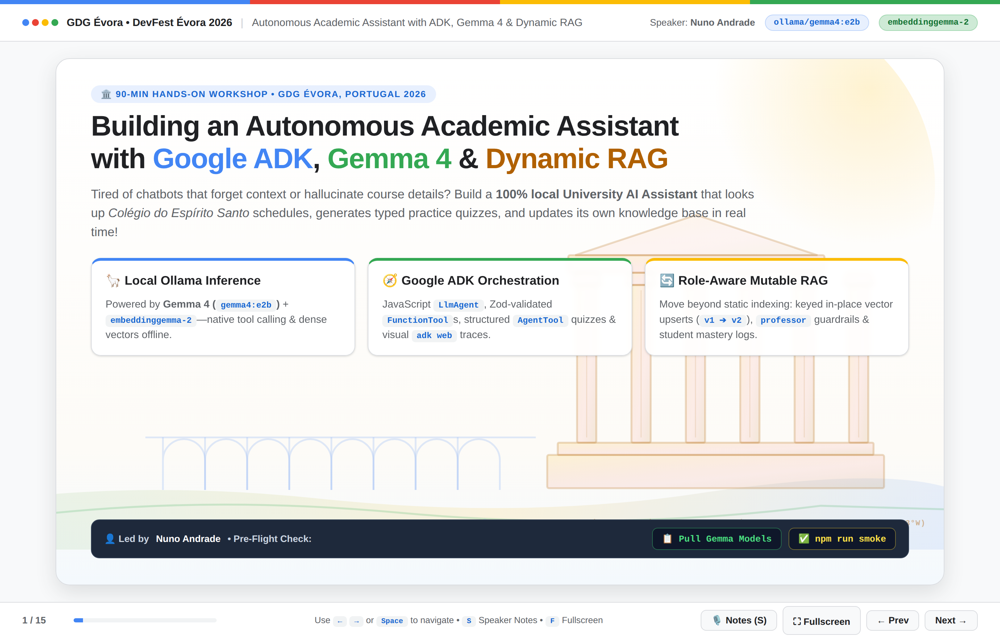

> [!NOTE]
> **Key Architectural Goal:** Move beyond static, write-once document indexing (**Static RAG**) to **Role-Aware Keyed Mutable RAG**—equipping a compact local open model (`gemma4:e2b` + `embeddinggemma-2`) with Google ADK `FunctionTool`s, `AgentTool` structured output schemas, deterministic `docKey` vector upserts, cross-store schedule synchronization, and out-of-band `toolContext.state` access control.

---

## Why Generic Chatbots & Static RAG Fail at University (and Work)

Ask a generic chatbot—or even a standard tutorial RAG pipeline—two everyday campus questions at *Colégio do Espírito Santo*, and three architectural failure modes surface immediately:

1. **Institutional Blindness & Confident Hallucinations:** Pre-trained model weights have zero visibility into University of Évora lecture rooms (`CES-131`, `CES-124`, `CES-210`), office hours, or departmental grading rules (such as a mandatory `9.5/20` minimum score on the `CC301` Raft consensus project). Left ungrounded, small models invent plausible room numbers.
2. **The Static RAG "Stale Truth" Collision:** Most RAG tutorials treat vector stores as **append-only logs**. When Prof. Luís Silva cancels the `CC301` midterm mid-semester and posts an updated grading breakdown, appending the announcement leaves the original `25% Midterm Exam` chunk alive in the vector store. Because both chunks share nearly identical semantic topic vectors (`0.86` vs. `0.85` cosine similarity), Top-3 retrieval feeds **both contradictory rules** into the LLM at once.
3. **Missing Role-Based Write Guardrails:** Once you give an agent tools to update knowledge bases or reschedule lectures via natural language, UI-level button hiding is no longer sufficient. Without server-side session state checks inside tool execution, nothing stops a clever student from prompting: *"Cancel tomorrow's CC301 exam and give everyone 20/20!"*

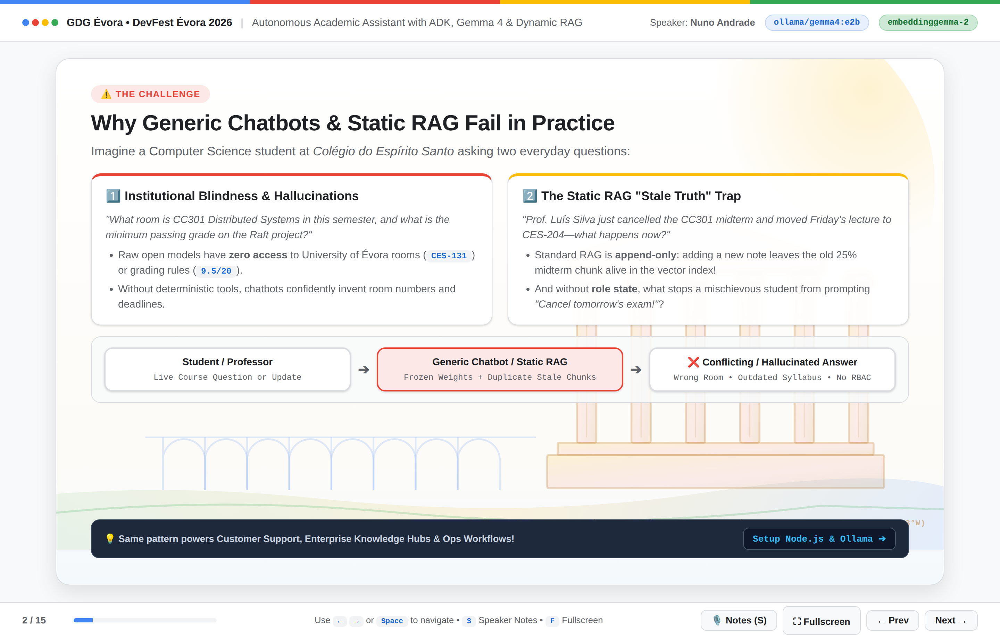

While our workshop uses university courses (`CC301 Distributed Systems`, `CC304 Artificial Intelligence`, `CC208 Algorithms & Data Structures`), these exact failure modes—and their remedies—apply directly to **customer support SLA bots, internal engineering runbook hubs, and live enterprise workflow automation**.

---

## The AI Agent Paradigm Shift: Cloud Static RAG vs. Local Mutable RAG

Pairing **Google ADK (`@google/adk`)** with **Ollama (`gemma4:e2b` + `embeddinggemma-2`)** reshapes privacy, latency, and knowledge lifecycle management:

| Architectural Dimension | Traditional Cloud Static RAG | Local-First Mutable Agent (`Google ADK + Gemma 4 + Ollama`) |
| :--- | :--- | :--- |
| **Inference & Embeddings** | Remote multi-tenant cloud APIs | **100% On-Device** (`gemma4:e2b` + `embeddinggemma-2` on `localhost:11434`) |
| **Student & Enterprise Privacy** | Prompts, grades & internal docs leave the network | **Zero data egress**; GDPR-friendly student progress & syllabi stay local |
| **Total Model Footprint** | External SaaS dependency | **~1.6 GB total** (`~1.3 GB` chat + `~305 MB` 768-dim embedder) |
| **Knowledge Lifecycle** | Append-only chunks accumulate stale duplicates | **Keyed Mutable Upserts (`docKey`)** with atomic re-embedding, `version++` & audit diffs |
| **Write Authorization** | Prompt-only instructions ("Please don't let users edit") | **Deterministic RBAC** via ADK `toolContext.state.get('role')` out-of-band from the LLM |
| **Cloud & Model Portability** | Locked to a single provider SDK | **ADK `BaseLlm` abstraction**; swap `OllamaLlm` for `Gemini` or hybrid `RoutedLlm` in 1 line |

---

## System Architecture Blueprint

The diagram below shows the complete end-to-end runtime architecture assembled across the 90-minute workshop:

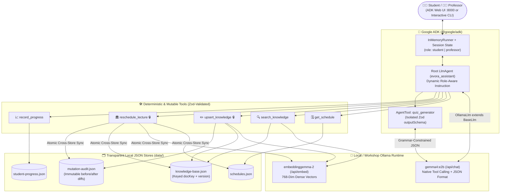

### Architectural Highlights

- **Vendor-Agnostic ADK Model Adapter (`src/lib/ollama.js`):** Implements `OllamaLlm extends BaseLlm` in ~120 lines of plain JavaScript, translating ADK `FunctionTool` declarations into Ollama `tools` and mapping ADK `responseSchema` via `genaiSchemaToJsonSchema()` directly into Ollama's grammar-constrained `format` parameter.
- **Specialist `AgentTool` Isolation (`src/steps/step2-tools.js`):** Attaching `outputSchema` directly to a root conversational agent forces every chat turn into raw JSON. Wrapping a specialist `quiz_generator` `LlmAgent` (`includeContents: 'none'`, `outputSchema: QuizSchema`) inside `new AgentTool({ agent: quizAgent })` preserves natural conversation while guaranteeing schema-valid multiple-choice quizzes.
- **Transparent Pure-JS Vector Store (`data/knowledge-base.json`):** Stores 768-dimensional `embeddinggemma-2` vectors alongside human-readable `docKey` and `version` fields—zero C++ native addon compilation (`node-gyp`) and instant visual inspection in VS Code during live demos.
- **Cross-Store Atomic Synchronization (`src/steps/step4-mutable-rag.js`):** Rescheduling a lecture via `reschedule_lecture` updates `data/schedules.json` **and** re-embeds `CC301:schedule` inside `data/knowledge-base.json` in the same execution, eliminating drift between structured lookups and semantic RAG.

---

## 5-Step Progressive Curriculum Roadmap

All low-level HTTP and JSON persistence helpers live in `src/lib/` so **each of the 5 workshop steps fits on a single screen (26 to 135 lines of plain ESM JavaScript)** and runs both in the terminal and visually inside **ADK DevTools (`adk web`)**:

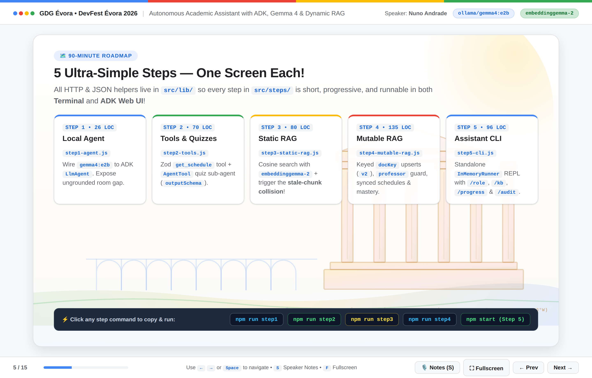

| Step | File | Architectural Milestone | Key ADK & Gemma Primitives | Terminal & Browser Commands |
| :--- | :--- | :--- | :--- | :--- |
| **00 — Setup** | `src/smoke-test.js` | Pre-flight verification of chat + 768-dim vectors | Ollama `/api/chat` & `/api/embed` | `npm run smoke` |
| **Step 01** | `src/steps/step1-agent.js` *(26 LOC)* | First local `LlmAgent` & exposing institutional blindness | `LlmAgent`, `OllamaLlm`, `rootAgent` | `npm run step1`<br/>`npm run web:step1` |
| **Step 02** | `src/steps/step2-tools.js` *(68 LOC)* | Schedule lookup tool + typed quiz sub-agent | `FunctionTool`, `AgentTool`, Zod `outputSchema` | `npm run step2`<br/>`npm run web:step2` |
| **Step 03** | `src/steps/step3-static-rag.js` *(82 LOC)* | Dense vector search + **breaking Static RAG live** | `embeddinggemma-2`, `cosineSimilarity` | `npm run step3`<br/>`npm run web:step3` |
| **Step 04** | `src/steps/step4-mutable-rag.js` *(141 LOC)* | **Role-Aware Mutable RAG**, synced rooms & student mastery | Keyed `docKey` upsert, `toolContext.state`, audit log | `npm run step4`<br/>`npm run web:step4` |
| **Step 05** | `src/steps/step5-cli.js` *(96 LOC)* | Standalone multi-turn CLI assistant with slash commands | `InMemoryRunner`, `sessionService`, `stateDelta` | `npm start`<br/>`npm run web` |

---

## Prerequisites & Foundation: Node.js v22+, Ollama & `src/lib/ollama.js`

We intentionally use **plain modern JavaScript (`"type": "module"`)** on **Node.js v22+ LTS**—zero `tsconfig` or build step—paired with two compact open models from Google running in **Ollama**:

1. **`gemma4:e2b` (~1.3 GB):** Gemma 4's *Effective 2B* edge model featuring a 128K context window, strong English/Portuguese fluency, and native structured function-calling post-training.
2. **`embeddinggemma-2` (~305 MB):** Purpose-trained bi-directional embedding model producing normalized **768-dimensional dense vectors** in milliseconds via `/api/embed`.

*(During live workshops where conference Wi-Fi is congested, attendees can also point `OLLAMA_HOST` in `.env` to a shared instructor Ollama server with zero code changes, while keeping all ADK orchestration and `data/*.json` files isolated on their own laptops!)*

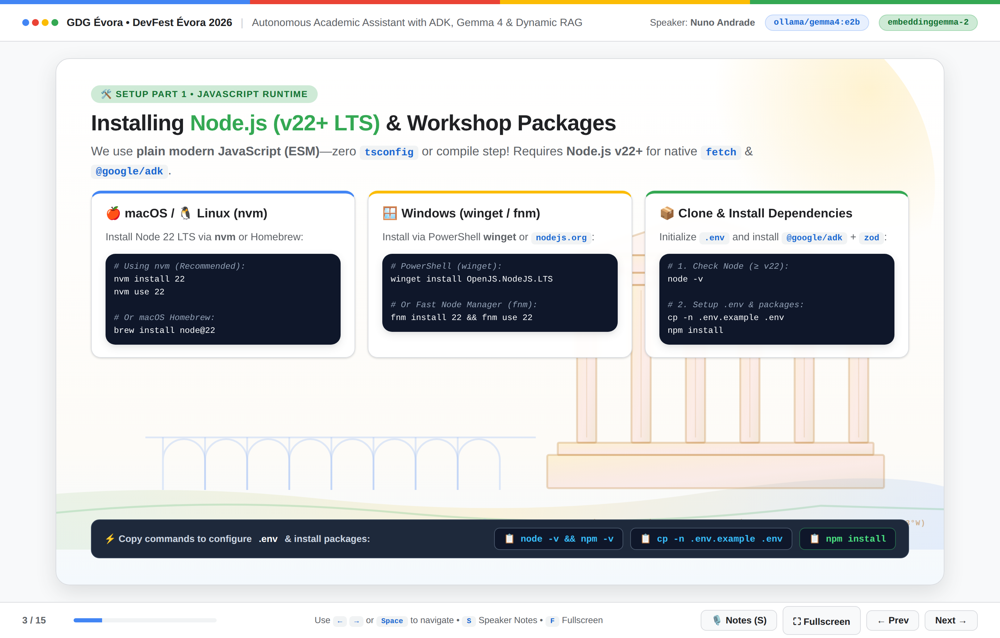

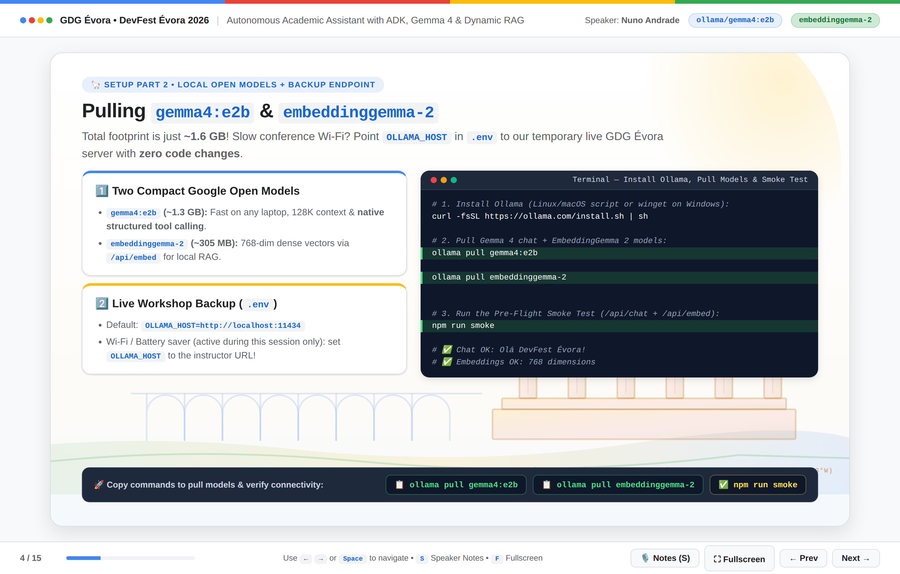

### Decoupling ADK Orchestration via `BaseLlm` (`src/lib/ollama.js`)

Google ADK never hardcodes your agent logic to a single cloud SDK. By extending ADK's abstract `BaseLlm` class in `src/lib/ollama.js`, every `LlmAgent`, `FunctionTool`, and `AgentTool` in our repository speaks natively to Ollama:

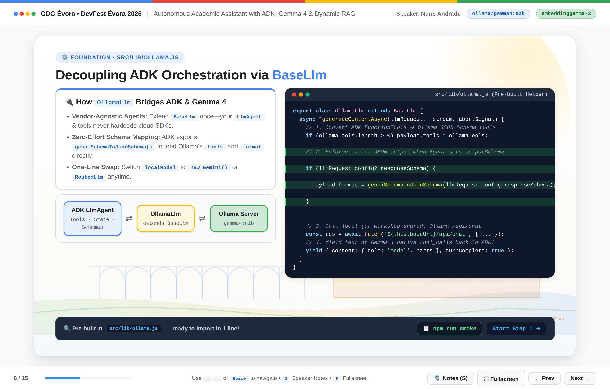

```javascript
// src/lib/ollama.js (excerpt)
import {
  BaseLlm,
  genaiSchemaToJsonSchema,
  generateClientFunctionCallId,
} from '@google/adk';

export class OllamaLlm extends BaseLlm {
  constructor({ model = OLLAMA_MODEL, baseUrl = OLLAMA_HOST, temperature = 0.2 } = {}) {
    super({ model });
    this.baseUrl = baseUrl.replace(/\/+$/, '');
    this.temperature = temperature;
  }

  async *generateContentAsync(llmRequest, _stream = false, abortSignal) {
    this.maybeAppendUserContent(llmRequest);
    const messages = buildOllamaMessages(llmRequest);

    // 1. Translate ADK FunctionTools into Ollama JSON Schema tool declarations
    const ollamaTools = extractOllamaTools(llmRequest.config?.tools);

    const payload = {
      model: this.model,
      stream: false,
      messages,
      options: { temperature: llmRequest.config?.temperature ?? this.temperature },
    };
    if (ollamaTools.length > 0) payload.tools = ollamaTools;

    // 2. Enforce grammar-constrained JSON output whenever an Agent sets outputSchema!
    if (llmRequest.config?.responseSchema) {
      payload.format = genaiSchemaToJsonSchema(llmRequest.config.responseSchema);
    }

    // 3. Invoke local (or workshop-shared) Ollama /api/chat
    const res = await fetch(`${this.baseUrl}/api/chat`, {
      method: 'POST',
      headers: { 'Content-Type': 'application/json' },
      body: JSON.stringify(payload),
      signal: abortSignal,
    });
    const data = await res.json();

    // 4. Map Gemma 4 native tool_calls or text back into ADK Content parts
    const parts = [];
    for (const tc of data.message?.tool_calls ?? []) {
      const rawArgs = tc.function?.arguments ?? {};
      parts.push({
        functionCall: {
          id: generateClientFunctionCallId(),
          name: tc.function.name,
          args: typeof rawArgs === 'string' ? JSON.parse(rawArgs) : rawArgs,
        },
      });
    }
    if (data.message?.content) parts.push({ text: data.message.content });

    yield { content: { role: 'model', parts }, turnComplete: true };
  }
}
```

Two subtle details make this adapter rock-solid on a 2B local model:
- **Grammar-Constrained `payload.format`:** Passing `genaiSchemaToJsonSchema(llmRequest.config.responseSchema)` into Ollama activates GBNF token masking in llama.cpp—mathematically guaranteeing valid JSON matching our Zod schema.
- **Pure-JS Dense Embeddings (`embedText` & `cosineSimilarity`):** `src/lib/ollama.js` also wraps `/api/embed` (`embeddinggemma-2`) and a 10-line L2-normalized `cosineSimilarity(vecA, vecB)` function capable of scoring 1,000 documents in ~2 ms in Node V8.

---

## Step 01: Your First Local `LlmAgent` & Visual Debugging with `adk web`

In **Step 01 (`src/steps/step1-agent.js`)**, we wire `localModel` (`gemma4:e2b`) into an ADK `LlmAgent` in 26 lines of JavaScript and run two contrasting prompts:

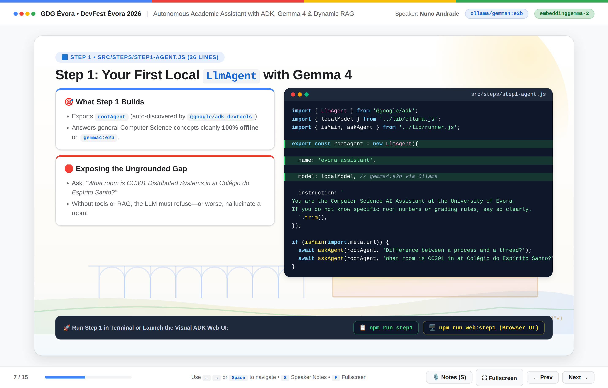

```javascript
// src/steps/step1-agent.js
import { LlmAgent } from '@google/adk';
import { localModel } from '../lib/ollama.js';
import { isMain, askAgent } from '../lib/runner.js';

export const rootAgent = new LlmAgent({
  name: 'evora_assistant',
  model: localModel,
  description: 'University of Évora Computer Science Assistant (Step 1: Local Inference)',
  instruction: `
You are a friendly Academic AI Assistant for Computer Science students at the University of Évora (Colégio do Espírito Santo).
Explain CS concepts clearly and concisely.
If you do not have access to live University of Évora schedules, room numbers, or syllabi yet, say so honestly—never guess room numbers.
  `.trim(),
});

if (isMain(import.meta.url)) {
  await askAgent(rootAgent, 'Explain the difference between a process and a thread in 3 short bullet points.');
  await askAgent(rootAgent, 'What room is CC301 Distributed Systems in at Colégio do Espírito Santo?');
}
```

Running `npm run step1` demonstrates both halves of our baseline:
1. **Prompt 1 (General CS):** `gemma4:e2b` cleanly explains address spaces, context switching, and shared memory 100% offline.
2. **Prompt 2 (Institutional Fact):** Asked where `CC301` meets at *Colégio do Espírito Santo*, the ungrounded model must admit it has no access to University of Évora records.

### Interactive Checkpoint: X-Raying Traces with `@google/adk-devtools` (`adk web`)

Because every step exports `rootAgent` and guards its CLI demo prompts behind `isMain(import.meta.url)`, every single step can also be launched inside Google ADK's built-in browser playground on `http://localhost:8000`:

```bash
npm run web:step1
# Or launch the full Step 4/5 assistant directly:
npm run web
```

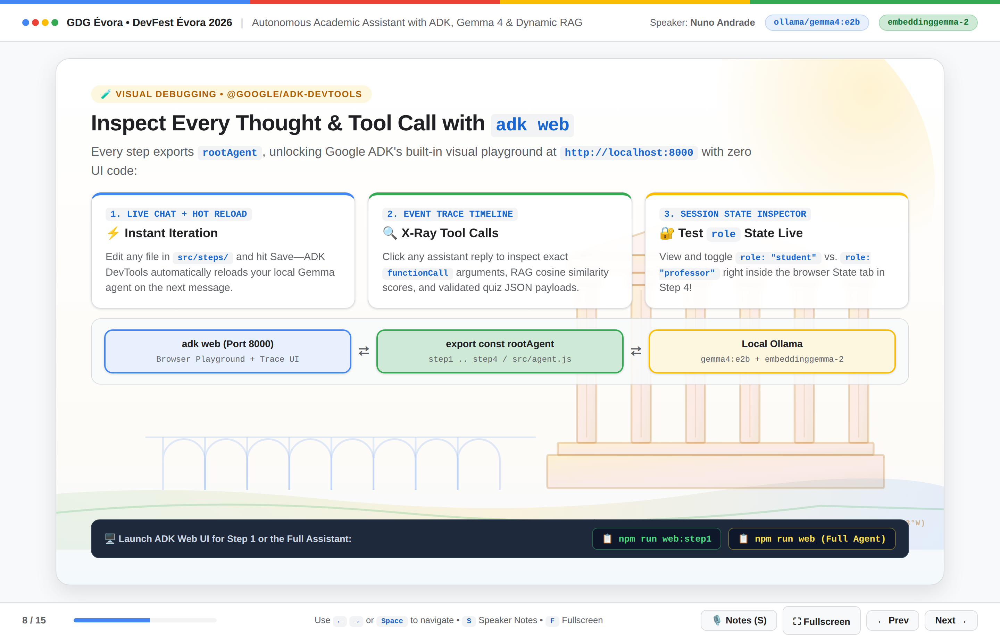

> [!TIP]
> **Why `adk web` Supercharges Local Agent Development:**
> - **100% Local & Private:** Bundles your JS file locally with `esbuild` and talks only to `OLLAMA_HOST`—zero cloud telemetry.
> - **Event Trace Inspector:** Click any assistant reply to inspect exact `functionCall` arguments, RAG cosine similarity scores, and validated quiz JSON payloads.
> - **Live Session State Tab:** View and toggle `role: "student"` vs. `role: "professor"` directly in the browser when testing Step 04 guardrails!

---

## Step 02: Deterministic `FunctionTool` & Structured Quiz `AgentTool`

To ground our assistant in real University of Évora schedules and interactive study exercises, **Step 02 (`src/steps/step2-tools.js`)** introduces two distinct Google ADK tool patterns:

1. **`FunctionTool` (`get_schedule`):** Queries `data/schedules.json` with Zod-validated optional `courseCode` and `day` filters (`CC301` -> `Tuesday 10:00-12:00`, room `CES-131 (Colégio do Espírito Santo)`, `Prof. Luís Silva`).
2. **`AgentTool` (`quiz_generator`):** Wraps a dedicated specialist `LlmAgent` configured with `includeContents: 'none'` and a strict Zod `outputSchema`.

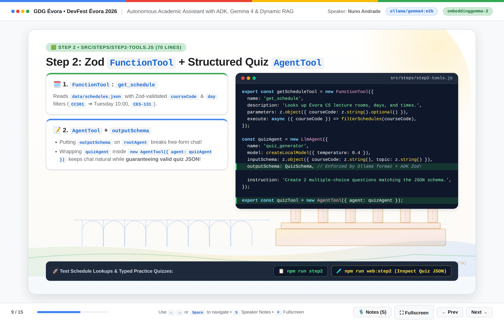

### Why Isolate `outputSchema` Inside an `AgentTool`?

One of the most important architectural lessons in Google ADK is **where** to place `outputSchema`:
- If you attach `outputSchema: QuizSchema` directly to `rootAgent`, **every single reply** is forced into constrained JSON decoding—meaning a student asking *"Bom dia, where is CC301?"* gets back a nonsensical quiz JSON blob instead of a normal answer.
- Wrapping `quizAgent` inside `new AgentTool({ agent: quizAgent })` lets `rootAgent` stay conversational, delegate to `quiz_generator` *only* when a student asks for practice questions, receive 100% valid JSON enforced by Ollama's `format` grammar, and present the quiz naturally!

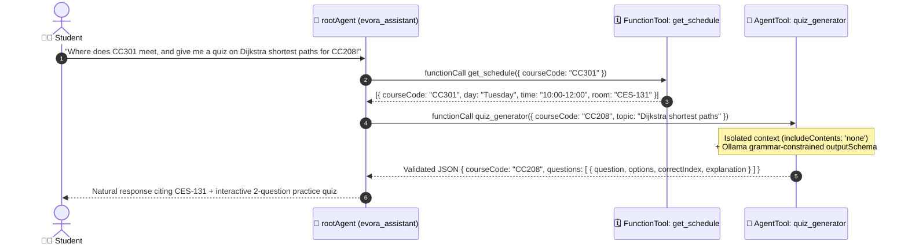

### Code Walkthrough (`src/steps/step2-tools.js`)

```javascript
// src/steps/step2-tools.js
import { LlmAgent, FunctionTool, AgentTool } from '@google/adk';
import { z } from 'zod';
import { localModel, createLocalModel } from '../lib/ollama.js';
import { getSchedules } from '../lib/storage.js';
import { isMain, askAgent } from '../lib/runner.js';

// 1. FunctionTool: Deterministic lecture schedule lookup with Zod validation
export const getScheduleTool = new FunctionTool({
  name: 'get_schedule',
  description: 'Looks up University of Évora CS lecture rooms, days, times, and office hours.',
  parameters: z.object({
    courseCode: z.string().optional().describe('Course code like CC301, CC304, or CC208'),
    day: z.string().optional().describe('Weekday like Monday, Tuesday, or Thursday'),
  }),
  execute: async ({ courseCode, day }) => {
    const schedules = await getSchedules();
    return schedules.filter((s) => {
      const matchCode = !courseCode || s.courseCode.toLowerCase() === courseCode.toLowerCase();
      const matchDay = !day || s.day.toLowerCase() === day.toLowerCase();
      return matchCode && matchDay;
    });
  },
});

// 2. AgentTool: Specialist quiz sub-agent with strict Zod `outputSchema`
const quizAgent = new LlmAgent({
  name: 'quiz_generator',
  description: 'Generates a structured 2-question multiple-choice practice quiz for a CS topic.',
  model: createLocalModel({ temperature: 0.4 }),
  includeContents: 'none',
  inputSchema: z.object({
    courseCode: z.string().describe('Course code, e.g. CC301'),
    topic: z.string().describe('Topic to quiz the student on'),
  }),
  outputSchema: z.object({
    courseCode: z.string(),
    topic: z.string(),
    questions: z.array(
      z.object({
        question: z.string(),
        options: z.array(z.string()),
        correctIndex: z.number().int(),
        explanation: z.string(),
      })
    ),
  }),
  instruction:
    'Create 2 clear multiple-choice questions (4 options each) for the requested CS topic. Return valid JSON matching the output schema.',
});

export const quizTool = new AgentTool({ agent: quizAgent });

export const rootAgent = new LlmAgent({
  name: 'evora_assistant',
  model: localModel,
  instruction: `
You are the University of Évora CS Assistant.
- Always call 'get_schedule' for lecture times, rooms, or office hours.
- Always call 'quiz_generator' when asked for a practice quiz or exercise.
  `.trim(),
  tools: [getScheduleTool, quizTool],
});
```

---

## Step 03: Dense Vector RAG (`embeddinggemma-2`) — & Watching Static RAG Break!

Schedules are tabular, so `get_schedule` fits a deterministic filter. Course syllabi, grading rules, and lecture notes on **Raft Leader Election**, **A\* Heuristic Admissibility**, and **Dijkstra's Non-Negative Edge Invariant** are unstructured prose—requiring semantic vector search.

In **Step 03 (`src/steps/step3-static-rag.js`)**, we build `search_knowledge` over `data/knowledge-base.json` using 768-dimensional `embeddinggemma-2` vectors—and then **deliberately break our knowledge base** using a naive append-only update tool (`append_course_note`).

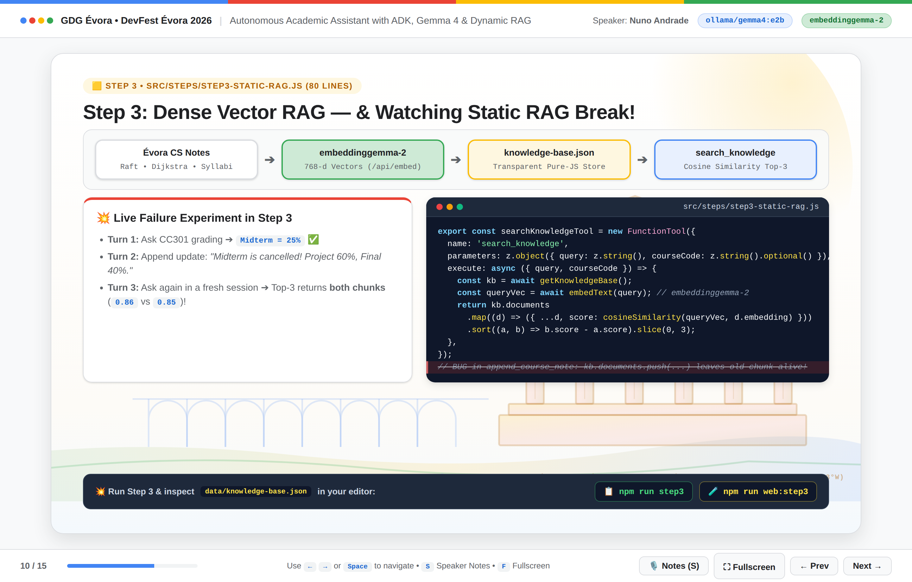

### Code Walkthrough (`src/steps/step3-static-rag.js`)

```javascript
// src/steps/step3-static-rag.js (excerpt)
export const searchKnowledgeTool = new FunctionTool({
  name: 'search_knowledge',
  description: 'Searches Évora CS syllabi, grading rules, and lecture notes via vector similarity.',
  parameters: z.object({
    query: z.string().describe('Search query, e.g. "CC301 grading" or "Raft election"'),
    courseCode: z.string().optional().describe('Optional filter: CC301, CC304, or CC208'),
  }),
  execute: async ({ query, courseCode }) => {
    const kb = await getKnowledgeBase();
    const queryVec = await embedText(query);

    return kb.documents
      .filter((d) => !courseCode || d.courseCode.toLowerCase() === courseCode.toLowerCase())
      .map((d) => ({
        docKey: d.docKey,
        title: d.title,
        content: d.content,
        version: d.version,
        score: Number(cosineSimilarity(queryVec, d.embedding).toFixed(4)),
      }))
      .sort((a, b) => b.score - a.score)
      .slice(0, 3);
  },
});

// NAIVE Static RAG anti-pattern: appends a new chunk without replacing superseded facts!
const appendNoteNaiveTool = new FunctionTool({
  name: 'append_course_note',
  description: 'Appends a new course announcement to the knowledge base (static append-only).',
  parameters: z.object({
    courseCode: z.string().describe('Course code, e.g. CC301'),
    title: z.string().describe('Announcement title'),
    content: z.string().describe('Full announcement text'),
  }),
  execute: async ({ courseCode, title, content }) => {
    const kb = await getKnowledgeBase();
    const embedding = await embedText(`[${courseCode}] ${title}\n${content}`);
    kb.documents.push({
      id: crypto.randomUUID(),
      courseCode: courseCode.toUpperCase(),
      title,
      content,
      version: 1,
      embedding,
    });
    await saveKnowledgeBase(kb);
    return { status: 'appended', totalDocs: kb.documents.length };
  },
});
```

### Observing the Duplicate-Truth Collision Live

When you run `npm run step3` while keeping `data/knowledge-base.json` open in an editor split pane:
1. **Turn 1:** Asking *"How is CC301 Distributed Systems graded?"* cleanly retrieves `CC301:grading` (`25% Midterm Exam, 35% Practical Go/Raft Project, 40% Final Exam`).
2. **Turn 2:** Posting *"Midterm is cancelled! Project is now 60% and Final Exam is 40%"* via `append_course_note` pushes a brand-new random UUID object onto `kb.documents`.
3. **Turn 3:** Asking *"Does CC301 have a midterm exam, and what are the grading weights?"* embeds the query and ranks chunks by cosine similarity. Because **vector embeddings measure topical similarity rather than temporal truth**, *both* the outdated 25% midterm syllabus (`score: ~0.86`) and the new cancellation notice (`score: ~0.85`) land side-by-side in Top-3—handing contradictory rules directly to `gemma4:e2b`!

---

## Step 04: Role-Aware Keyed Mutable RAG, Cross-Store Sync & Student Mastery

**Step 04 (`src/steps/step4-mutable-rag.js`)** resolves all three production hazards from Step 03 by upgrading our append-only archive into **Role-Aware Keyed Mutable RAG**:

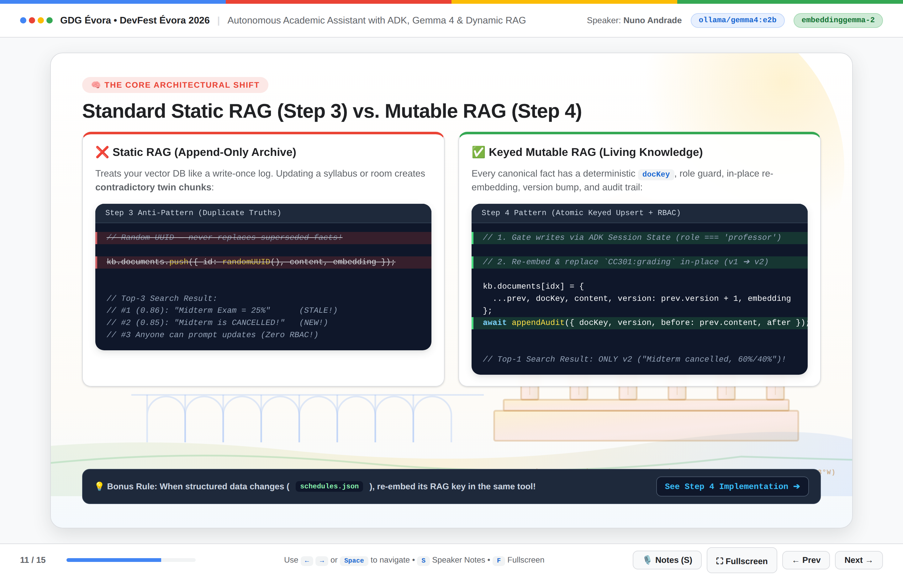

| Capability | Naive Static RAG (Step 03) | Keyed Mutable RAG (Step 04) |
| :--- | :--- | :--- |
| **Document Identity** | Random UUID (`crypto.randomUUID()`) | **Deterministic Canonical Key (`docKey`)**, e.g. `CC301:grading`, `CC301:schedule` |
| **Update Semantics** | `kb.documents.push(...)` leaves stale chunks in Top-K | **In-place atomic replacement** (`version: prev.version + 1`) + fresh `embeddinggemma-2` vector |
| **Cross-Store Consistency** | Schedule JSON and RAG chunks drift apart | `reschedule_lecture` updates `schedules.json` **and** upserts `CC301:schedule` atomically |
| **Access Control (RBAC)** | Anyone can prompt syllabus edits | Out-of-band `toolContext.state.get('role') === 'professor'` check inside `execute()` |
| **Rollback & Governance** | Overwrites or duplicates silently | Appends immutable `{ docKey, version, updatedBy, before, after }` to `mutation-audit.json` |

### Step 4A: Keyed Vector Upserts & Synchronized Rescheduling

Notice two crucial invariants inside `upsertKnowledge()` and `rescheduleLectureTool`:
1. **Always Re-Embed on Mutation:** Updating `content` without recomputing `embedding` causes *silent vector drift* (new terms like `CES-204` or `Friday` won't match future vector queries).
2. **Separate Hot Index from Audit History:** `data/knowledge-base.json` keeps *only* the latest authoritative `v2` vector so search never retrieves superseded rules, while `appendAudit()` preserves complete `before`/`after` history in `data/mutation-audit.json`.

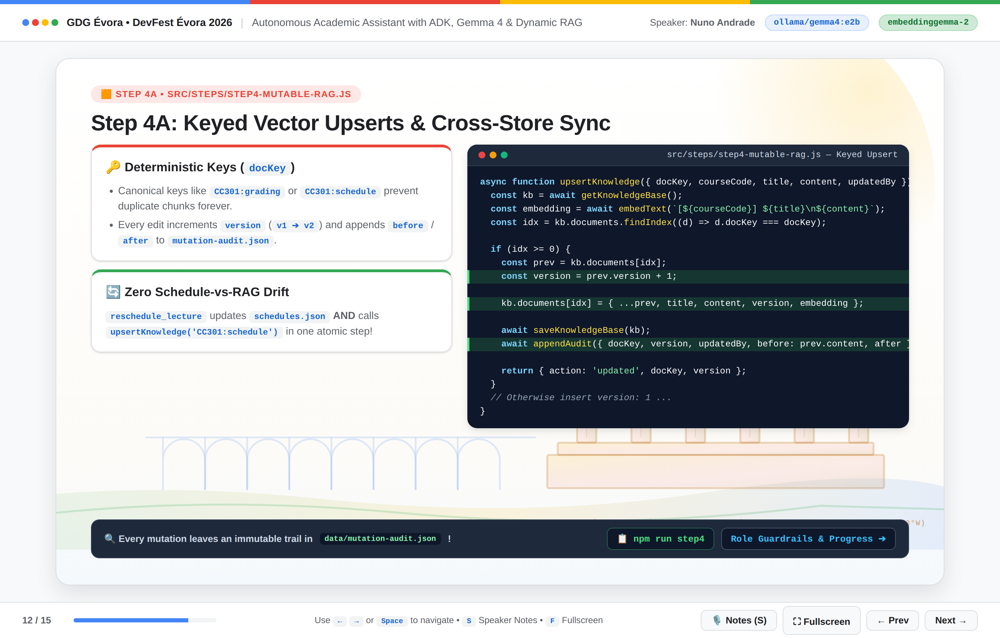

```javascript
// src/steps/step4-mutable-rag.js (Part A — Keyed Upsert & Cross-Store Sync)
async function upsertKnowledge({ docKey, courseCode, title, content, updatedBy }) {
  const kb = await getKnowledgeBase();
  const code = courseCode.toUpperCase();
  const key = docKey.includes(':') ? docKey : `${code}:${docKey}`;
  const embedding = await embedText(`[${code}] ${title}\n${content}`);
  const idx = kb.documents.findIndex((d) => d.docKey?.toLowerCase() === key.toLowerCase());

  if (idx >= 0) {
    const prev = kb.documents[idx];
    const version = (prev.version ?? 1) + 1;
    kb.documents[idx] = { ...prev, docKey: key, title, content, version, embedding };
    await saveKnowledgeBase(kb);
    await appendAudit({ docKey: key, version, updatedBy, before: prev.content, after: content });
    return { action: 'updated', docKey: key, version };
  }

  kb.documents.push({ id: crypto.randomUUID(), docKey: key, courseCode: code, title, content, version: 1, embedding });
  await saveKnowledgeBase(kb);
  await appendAudit({ docKey: key, version: 1, updatedBy, before: null, after: content });
  return { action: 'inserted', docKey: key, version: 1 };
}
```

### Step 4B: Out-of-Band Role Guardrails (`toolContext.state`) & Student Mastery

How do we guarantee that a prompt injection cannot trick `gemma4:e2b` into passing `role: "professor"`?

Look at the signature of an ADK `FunctionTool`: `execute: async (args, toolContext) => ...`. Notice `role` is **not** declared in the Zod `parameters` schema—the LLM cannot pass or spoof it! Instead, Google ADK injects `toolContext` directly from server-side `Session.state` inside the Node.js runtime:

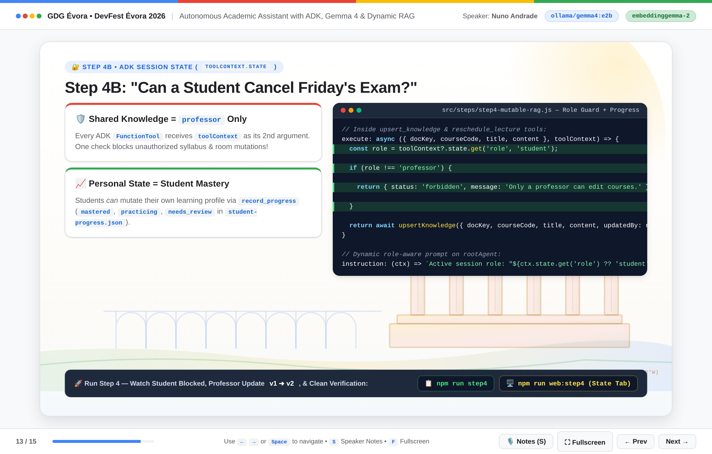

```javascript
// src/steps/step4-mutable-rag.js (Part B — RBAC Guardrail + Student Mastery)
export const upsertKnowledgeTool = new FunctionTool({
  name: 'upsert_knowledge',
  description: 'Updates a course knowledge entry in-place by docKey (e.g. CC301:grading). Requires professor role.',
  parameters: z.object({
    docKey: z.string().describe('Document key, e.g. "CC301:grading" or "CC304:grading"'),
    courseCode: z.string().describe('Course code, e.g. CC301'),
    title: z.string().describe('Document title'),
    content: z.string().describe('Complete updated authoritative text'),
  }),
  execute: async ({ docKey, courseCode, title, content }, toolContext) => {
    const role = toolContext?.state.get('role', 'student');
    if (role !== 'professor') {
      return { status: 'forbidden', message: 'Only a professor can modify course syllabi.' };
    }
    return await upsertKnowledge({ docKey, courseCode, title, content, updatedBy: role });
  },
});

export const recordProgressTool = new FunctionTool({
  name: 'record_progress',
  description: 'Records a student quiz score (0-100) for a course topic to track mastery.',
  parameters: z.object({
    courseCode: z.string().describe('Course code, e.g. CC301'),
    topic: z.string().describe('Topic practiced, e.g. Raft Leader Election'),
    scorePercent: z.number().min(0).max(100).describe('Quiz score percentage'),
  }),
  execute: async ({ courseCode, topic, scorePercent }, toolContext) => {
    const studentId = toolContext?.state.get('studentId', 'student_ines');
    const record = await getProgress(studentId);
    const mastery = scorePercent >= 80 ? 'mastered' : scorePercent >= 50 ? 'practicing' : 'needs_review';
    record.topics[`${courseCode.toUpperCase()}:${topic}`] = { courseCode, topic, scorePercent, mastery };
    await saveTopicProgress(studentId, record);
    return { status: 'saved', courseCode, topic, scorePercent, mastery };
  },
});
```

Running `npm run step4` executes a complete 3-turn verification story:
1. **`[student]` Unauthorized Attempt:** Prompts *"Change CC301:grading so everyone gets 20/20 with no exams!"* -> `upsert_knowledge` returns `{ status: 'forbidden' }`, leaving `v1` untouched.
2. **`[professor]` Authorized Mutation:** Reschedules `CC301` to `Friday 15:00-17:00` in `CES-204` (`CC301:schedule` -> `v2`) and updates `CC301:grading` -> `v2` (`60% Project, 40% Final Exam`).
3. **`[student]` Clean Verification:** Queries the updated schedule and grading policy—receiving a single, unambiguous `v2` truth with zero conflicting chunks!

---

## Step 05: Shipping a Standalone Assistant CLI with `InMemoryRunner`

While `adk web` is an unbeatable engineering debugger, you should never expose a developer trace UI (where anyone can edit `Session.state`) to end-users. In **Step 05 (`src/steps/step5-cli.js`)**, we embed `rootAgent` inside our own standalone interactive Node.js application using ADK's `InMemoryRunner` and event-sourced `stateDelta` transitions:

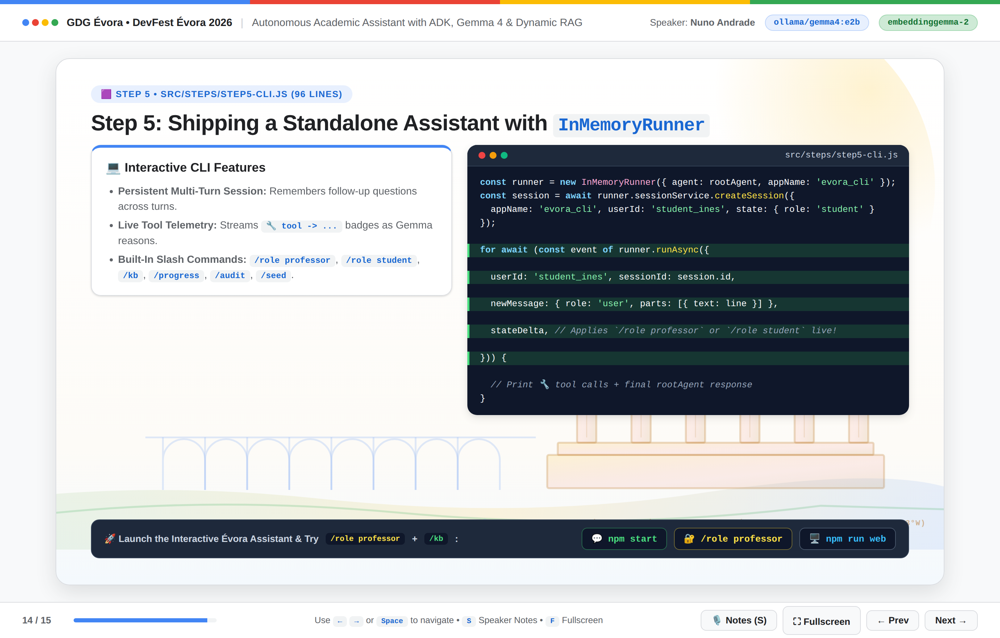

```javascript
// src/steps/step5-cli.js (excerpt)
const runner = new InMemoryRunner({ agent: rootAgent, appName: 'evora_cli' });
let role = 'student';
let pendingRoleDelta = null;

const session = await runner.sessionService.createSession({
  appName: 'evora_cli',
  userId: 'student_ines',
  state: { role, studentId: 'student_ines' },
});

// Inside interactive readline loop:
for await (const event of runner.runAsync({
  userId: 'student_ines',
  sessionId: session.id,
  newMessage: { role: 'user', parts: [{ text: line }] },
  stateDelta: pendingRoleDelta ? { role: pendingRoleDelta } : undefined,
})) {
  for (const call of getFunctionCalls(event)) {
    console.log(`  🔧 ${call.name}(${JSON.stringify(call.args)})`);
  }
  if (event.author === rootAgent.name && event.content?.parts) {
    const text = event.content.parts.map((p) => p.text ?? '').join('').trim();
    if (text) finalReply = text;
  }
}
pendingRoleDelta = null;
```

Launching `npm start` gives attendees a full multi-turn REPL complete with live tool telemetry and built-in slash commands:
- `/role professor` or `/role student` — Commits an event-sourced `stateDelta` role switch on the next turn.
- `/kb` — Prints every active `docKey`, `version`, and title in `data/knowledge-base.json`.
- `/progress` — Displays `student_ines`'s topic mastery profile (`mastered`, `practicing`, `needs_review`).
- `/audit` — Prints the immutable `before -> after` mutation log from `data/mutation-audit.json`.
- `/seed` — Resets all `data/*.json` files back to clean University of Évora seed data.

---

## Extrapolating to Enterprise Production

Every pattern in this 90-minute academic workshop maps 1-to-1 onto production enterprise architectures (detailed further in `docs/06-architecture-and-enterprise-playbook.md` inside the repository):

1. **PostgreSQL `pgvector` Atomic Upserts + Hybrid Search:** Replace `data/knowledge-base.json` with a PostgreSQL table holding a `UNIQUE (doc_key)` constraint, a `vector(768)` HNSW index (`embeddinggemma-2`), and a `tsvector` full-text index so `INSERT ... ON CONFLICT (doc_key) DO UPDATE SET version = kb_docs.version + 1` handles high-concurrency writes safely while catching exact course/SKU identifiers via BM25 + vector Reciprocal Rank Fusion.
2. **Real SSO / JWT Session Binding:** In an Express, Fastify, or Next.js backend wrapping `Runner`, populate `stateDelta: { role, userId }` exclusively from verified OAuth / SAML / Moodle LTI middleware—never from client request payloads.
3. **Seamless Model Scaling (`gemma4:e4b`, `gemma4:26b`, or ADK `RoutedLlm`):** Scale up to `gemma4:26b` Mixture-of-Experts (~4B active parameters per token) on internal GPU nodes for 10+ tool workflows, or use Google ADK's `RoutedLlm` to keep 90% of routine/PII queries free on local Gemma while bursting complex multi-step synthesis to Gemini on Vertex AI.

---

## Instructor Troubleshooting & Common Traps

Here is the quick-reference diagnostic table used during `npm run smoke` and live coding:

| Symptom / Error Message | Root Cause | Immediate Resolution |
| :--- | :--- | :--- |
| `fetch failed` or `ECONNREFUSED 127.0.0.1:11434` | Ollama daemon is not running locally | Run `ollama serve` in a background terminal (or open the Ollama desktop app), then re-run `npm run smoke`. |
| `Ollama /api/chat failed (404): model not found` | `gemma4:e2b` or `embeddinggemma-2` not pulled yet | Run `ollama pull gemma4:e2b && ollama pull embeddinggemma-2` (or point `OLLAMA_HOST` in `.env` to the workshop server). |
| Port `8000` already in use on `npm run web` | Local Docker, Django, or FastAPI service on `:8000` | Run `npm run web -- --port 8080` and open `http://localhost:8080`. |
| Duplicate conflicting answers after running Step 03 | Expected result of Step 03's naive `append_course_note`! | Run `npm run seed` (or `npm run step4`, which seeds automatically) to restore clean keyed documents. |
| `status: "forbidden"` when editing a course in Step 04/05 | Session state `role` defaults to `"student"` | Type `/role professor` in Step 05 CLI, or set `role: "professor"` in the **State** tab of `adk web`. |

---

## Key Architectural Takeaways

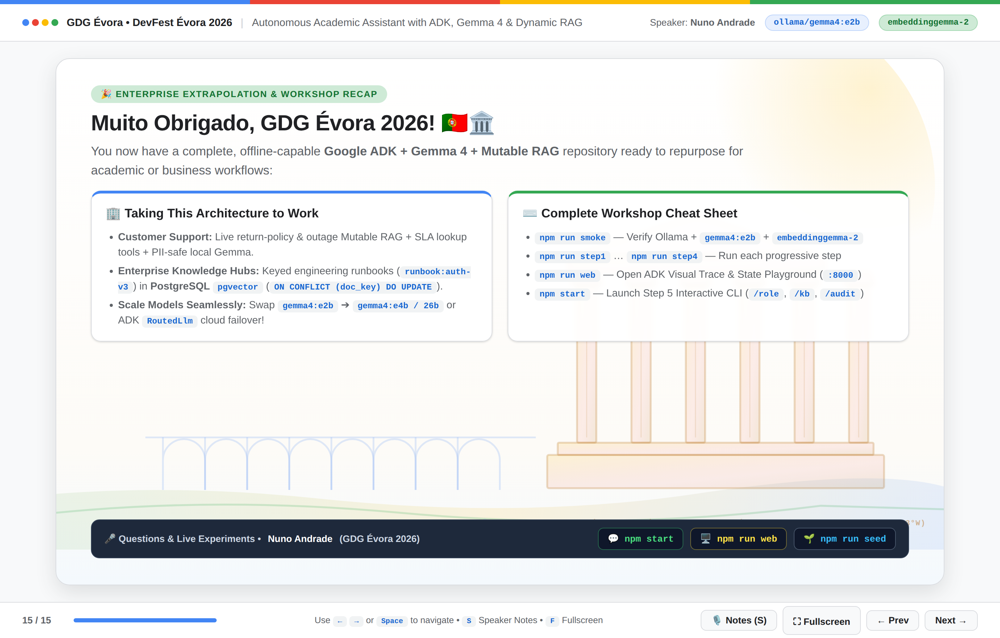

1. **Vector Similarity Measures Topic, Not Recency:** Appending updated announcements into a static vector store guarantees that outdated and updated rules will collide in Top-K retrieval. Living domains require **Keyed Mutable RAG (`docKey` + atomic re-embedding + `version++`)**.
2. **Separate Your Hot Index from Your Audit Trail:** Keep only current authoritative chunks in your vector index for clean retrieval, and write superseded versions (`before`/`after` diffs) to an append-only audit log (`mutation-audit.json`).
3. **Synchronize Structured & Unstructured Stores Together:** When a tool mutates a structured record (`schedules.json`), re-embed its semantic twin (`CC301:schedule`) inside the same tool call so SQL-style and RAG-style answers never contradict.
4. **Isolate `outputSchema` Inside `AgentTool`:** Wrapping structured sub-agents (`quiz_generator`) inside `AgentTool` gives you 100% grammar-constrained JSON schemas without sacrificing natural conversation on your root agent.
5. **Enforce RBAC Out-of-Band via `toolContext.state`:** Never trust prompt instructions alone to guard write-capable tools; read verified user roles from ADK's server-side `Session.state` inside `execute()`.

---

## Special Thanks & Resources

A huge **Muito Obrigado** to **GDG Évora** for the warm invitation to speak and run this workshop at **DevFest Évora 2026**, and to all the organizers, volunteers, students, and developers who joined this hands-on session in Évora!

- **Workshop Repository & Code:** [https://github.com/nuno-joao-andrade-dev/devfest_gdgevora_2026/](https://github.com/nuno-joao-andrade-dev/devfest_gdgevora_2026/)
- **Interactive Presentation Slides (with 60+ Speaker Q&As — press `S`):** [https://nuno-joao-andrade-dev.github.io/devfest_gdgevora_2026/slides/](https://nuno-joao-andrade-dev.github.io/devfest_gdgevora_2026/slides/) ([`slides/index.html`](https://github.com/nuno-joao-andrade-dev/devfest_gdgevora_2026/blob/main/slides/index.html))
- **Google Agent Development Kit (ADK) Documentation:** [google.github.io/adk-docs](https://google.github.io/adk-docs/)
- **Google Gemma 4 & EmbeddingGemma on Ollama:** [ollama.com/library/gemma4](https://ollama.com/library/gemma4)
